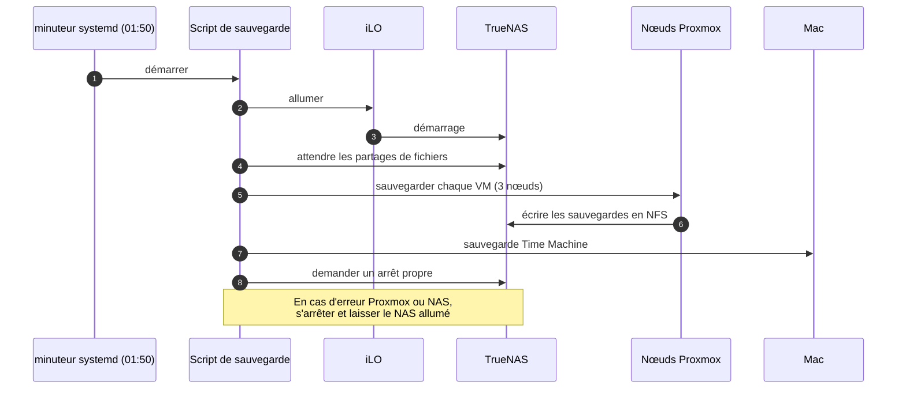

<Tldr>

- **Quoi :** un HP MicroServer Gen8 d'occasion transformé en NAS de sauvegarde sous TrueNAS, réveillé chaque nuit à 1 h 50.
- **Idées clés :** iLO me permet de l'allumer à distance, et le script laisse le NAS allumé si quoi que ce soit se passe mal.
- **Manque :** une copie hors site, et un test de restauration complet.

</Tldr>

Auto-héberger mes propres données n'a de sens que si je peux les restaurer. La première chose que j'ai construite autour de mon homelab n'a donc pas été un service, mais une **machine de sauvegarde** : un petit serveur HP sous TrueNAS, réveillé chaque nuit pour faire son travail puis remis en veille.

<Callout tone="brand">Je n'ai pas inventé la partie matérielle. J'ai suivi un guide écrit et deux vidéos (tous crédités plus bas), puis j'ai construit l'automatisation par-dessus. Cet article est ma version de l'histoire.</Callout>

## La machine : le HP MicroServer Gen8

Le HP MicroServer Gen8 est un petit serveur silencieux de la famille ProLiant de HP, facile à trouver d'occasion. Il a quatre baies de disques durs, deux ports réseau et — la fonction qui compte le plus pour moi — un port de gestion dédié pour **iLO**.

### Pourquoi iLO compte

iLO (*Integrated Lights-Out*) est un contrôleur de gestion intégré au serveur. C'est un minuscule ordinateur à l'intérieur de l'ordinateur, joignable sur son propre port réseau **même quand le serveur est éteint**. Il me permet de :

- ouvrir une console distante, comme si un écran était branché, pour ne jamais avoir besoin de moniteur ;
- allumer, éteindre ou réinitialiser le serveur, depuis une page web ou en ligne de commande.

Pour une machine de sauvegarde, c'est exactement ce que je veux. Le NAS n'a pas besoin de tourner toute la journée. Avec iLO, autre chose peut l'allumer quand il le faut, et je peux toujours le joindre — même si le système d'exploitation est cassé.

## Remplacer le lecteur optique par un SSD

Le serveur a une baie de lecteur CD/DVD dont personne n'a plus besoin. J'ai remplacé le lecteur par un adaptateur contenant un **SSD 2,5 pouces**. Cela donne au système d'exploitation son propre disque, et garde les quatre baies libres pour les données.

### Alimenter le SSD : couper le câble, faire un pont sur l'alimentation

Le SSD a besoin d'être alimenté en plus des données, et le connecteur d'alimentation du lecteur optique n'est pas le SATA habituel. Dans mon cas, cela a demandé un peu de travail manuel : **j'ai dû couper le câble du lecteur optique et faire un pont sur l'alimentation du serveur** pour alimenter le SSD depuis celle-ci. C'est l'étape la moins élégante de tout le projet, et celle qui demande le plus de soin.

<Callout tone="critical">Ne le faites qu'avec le serveur **débranché** du secteur. Couper et raccorder un câble d'alimentation est une modification matérielle : vérifiez deux fois chaque connexion avant de rallumer la machine, et faites-le à vos risques.</Callout>

### Le faire démarrer (la partie difficile)

C'est là que ça a cessé d'être facile. Par défaut, le Gen8 ne démarre que depuis son emplacement microSD ou depuis l'une des quatre baies principales — **pas** depuis un disque dans la baie optique. Y mettre le SSD ne suffit pas.

La solution consiste à déclarer le SSD au contrôleur de stockage du serveur comme un volume d'un seul disque, avec l'outil Smart Storage de HPE, puis à marquer ce volume comme **volume de démarrage principal**. À partir de là, le serveur démarre depuis le SSD. La difficulté n'était pas de le faire, c'était de **trouver comment** : rien dans la machine ne laisse penser que c'est possible, et la réponse est dispersée entre des messages de forums, un guide écrit et quelques vidéos. Une fois la procédure exacte connue, les étapes elles-mêmes sont courtes — et elles se font depuis les écrans du firmware, via la console distante iLO, donc je n'ai jamais eu besoin d'un moniteur.

## Améliorer le processeur et la mémoire

Un NAS qui fait tourner ZFS profite d'un peu plus de puissance et de **mémoire ECC**, qui détecte et corrige les erreurs de mémoire, la recommandation habituelle pour une machine sous ZFS. J'ai donc mis à niveau le serveur :

<Table
  data={{
    headers: [
      { content: "Pièce", key: "part" },
      { content: "Maintenant", key: "now" }
    ],
    rows: [
      ["Processeur", "Intel Xeon E3-1265L v2, 2,50 GHz"],
      ["Mémoire", "2 × 8 Go DDR3 ECC"]
    ]
  }}
/>

Les processeurs Xeon « L » sont les versions basse consommation, ce qui convient à une machine censée rester silencieuse et peu coûteuse à faire tourner.

## TrueNAS et le pool de stockage

Une fois le disque système réglé, j'ai installé **TrueNAS Community Edition** et créé un pool de stockage sur les quatre baies : deux disques de 4 To et deux disques de 3 To, en **RAIDZ1**, l'équivalent ZFS du RAID 5. Un pool RAIDZ1 survit à la perte d'un disque quelconque.

Mélanger les tailles a un coût qu'il vaut mieux connaître : dans un groupe RAIDZ1, chaque disque n'est utilisé qu'à hauteur du plus petit, donc chaque disque de 4 To est utilisé comme s'il en faisait 3. Le pool me donne tout de même **environ 7,8 TiB utilisables**, dont mes sauvegardes occupent environ 1,2 TiB aujourd'hui.

Dans le pool, j'ai créé deux datasets, un pour chaque type de sauvegarde :

<Table
  data={{
    headers: [
      { content: "Dataset", key: "ds" },
      { content: "Partagé avec", key: "sh" },
      { content: "Contient", key: "holds" }
    ],
    rows: [
      ["proxmox-backups", "Les nœuds Proxmox, en NFS", "Les sauvegardes de toutes mes machines virtuelles (environ 0,6 TiB)"],
      ["TimeMachine", "Mon Mac et le Mac mini, en SMB", "Leurs sauvegardes Time Machine, un sous-dataset par machine (environ 0,65 TiB pour l'instant), avec une limite d'espace d'environ 2,5 TiB"]
    ]
  }}
/>

La limite sur le dataset Time Machine a un but pratique : Time Machine grossit pour remplir tout l'espace qu'on lui donne, donc le plafonner l'empêche de priver les autres sauvegardes. Ce qui m'importe le plus, c'est *la façon dont les sauvegardes sont exposées* :

- un **dataset dédié** pour les sauvegardes Proxmox, jamais la racine du pool, pour que le partage ne puisse toucher que ce qu'il doit ;
- un **utilisateur et un groupe dédiés** propriétaires de ce dataset ;
- un **partage NFS** restreint aux seules adresses de mes trois nœuds Proxmox.

Proxmox le voit comme une cible de stockage. Une tâche de sauvegarde quotidienne, définie dans Terraform comme le reste de mon infrastructure, sauvegarde chaque machine virtuelle en mode instantané, compressée, et garde les 7 dernières sauvegardes plus 4 hebdomadaires et 6 mensuelles :

```hcl
resource "proxmox_backup_job" "truenas_daily" {
  schedule = "*-*-* 02:00"
  all      = true
  mode     = "snapshot"
  compress = "zstd"

  prune_backups = {
    "keep-last"    = "7"
    "keep-weekly"  = "4"
    "keep-monthly" = "6"
  }
}
```

Quand le script de 1 h 50 est aux commandes, cette tâche intégrée est désactivée, pour qu'une sauvegarde ne tourne pas deux fois.

## Le script de 1 h 50

Une machine qui tourne 24 heures sur 24 juste pour recevoir des sauvegardes pendant quelques minutes gaspille de l'énergie. Le NAS est donc **éteint la plupart du temps**, et un petit script le réveille.



L'exécution nocturne complète dure environ **une heure**, plus ou moins, selon ce qui a changé depuis la veille. C'est pourquoi elle démarre à 1 h 50 : elle est terminée bien avant que je sois réveillé.

Le script vit dans mon dépôt de homelab et il est déployé par le même pipeline que tout le reste, donc rien n'est configuré à la main sur le nœud Proxmox. Le planning lui-même est un petit minuteur systemd :

```ini
[Timer]
OnCalendar=*-*-* 01:50:00
Persistent=true
Unit=nas-backup-orchestrator.service
```

`Persistent=true` signifie que si le nœud Proxmox était éteint à 1 h 50, la tâche s'exécute dès son retour, au lieu d'être ignorée en silence.

### Concevoir pour l'échec

La partie intéressante, c'est ce que fait le script quand quelque chose se passe mal :

- Si une **erreur Proxmox ou NAS** survient, il s'arrête et **laisse le NAS allumé**. Je préfère une machine qui reste allumée à une machine coupée en plein milieu d'une écriture.
- Si un **Mac est en veille**, il réessaie pendant une minute, journalise un avertissement et continue avec les autres.
- Un **mode à blanc** teste les connexions sans rien sauvegarder ni éteindre.
- Il n'utilise jamais iLO pour éteindre le NAS : l'arrêt passe par une vraie demande à TrueNAS, pour que le pool soit fermé proprement.

### Un compte iLO dédié

Le script ne se connecte pas à iLO en administrateur. J'ai créé un compte dédié avec seulement trois droits : alimentation virtuelle et réinitialisation, accès à la console distante et médias virtuels. Si ses identifiants fuitaient, il ne pourrait pas faire grand-chose. C'est une habitude que je veux garder : **chaque automatisation a son propre compte avec le minimum nécessaire**.

## Ce que cela ne me donne pas

C'est une sauvegarde dans la même maison que les originaux. Elle protège contre un disque en panne, une VM supprimée ou un mauvais changement ; elle ne protège **pas** contre un incendie, un vol ou une surtension qui détruit les deux machines. Une copie hors site est la pièce manquante, et elle est sur ma liste.

## Le test que je me dois encore

Une sauvegarde qui n'a jamais été restaurée n'est qu'un espoir, et je n'ai pas encore fait de test de restauration complet. Je prévois de le faire plus tard, avec une question précise : **en partant uniquement des sauvegardes, puis-je tout récupérer ?** Cela veut dire :

- le **Mac mini** (une machine de 256 Go, dont la sauvegarde Time Machine vit sur le NAS) ;
- les **trois nœuds Proxmox** ;
- et **toutes les machines virtuelles** qui tournent dessus.

J'en publierai le résultat ici, y compris ce qui échoue : un test de restauration qui se passerait parfaitement du premier coup serait suspect.

## Crédits

La préparation matérielle — iLO, remplacer le lecteur optique par un disque et le déclarer amorçable — suit le guide de McFly, [HP MicroServer Gen8 — Mise en service et installation d'un OS](https://mcflypartages.fr/blog/hp_gen_8_mise_en_place/) sur McFlyPartages. C'est un pas-à-pas clair et pratique, et je le recommande si vous voulez faire la même chose.

Deux vidéos m'ont aussi aidé :

- [HP Proliant Microserver Gen8 SSD in Optical bay](https://www.youtube.com/watch?v=co8wuIUpDJc) par No Tech Drama, pour le SSD dans la baie optique.
- [Upgrading HP Proliant Gen8 Microserver (Part 1) — Performance](https://youtu.be/-nWmb2GdqHc) par AnChan Tech, pour la mise à niveau du processeur et de la mémoire.

La façon dont tout cela s'intègre au reste de mon labo est décrite dans [Provisionner Proxmox avec Terraform et GitLab CI/CD](/fr/blog/proxmox-terraform-gitlab-ci).
