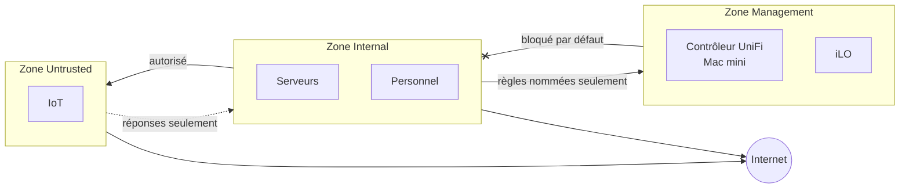

<Tldr>

- **Quoi :** quatre VLAN sur UniFi (Management, Serveurs, Personnel, IoT), regroupés en trois zones de pare-feu.
- **Le résultat :** je peux joindre mes appareils IoT, mais ils ne peuvent pas engager de conversation avec mes machines.
- **La leçon :** taguer un VLAN à un seul endroit, et donner à chaque règle de pare-feu un nom qui dit pourquoi elle existe.

</Tldr>

Un homelab cesse vite d'être « quelques machines sur le réseau de la maison ». Dès que les photos, la domotique et les sauvegardes vivent sur du matériel qui m'appartient, je veux contrôler **qui peut parler à qui**. Cet article explique comment j'ai construit mon réseau local autour de cette idée, avec du matériel UniFi et des VLAN séparés.

<Callout tone="brand">Je suis un apprenti, pas un ingénieur réseau. Je décris ce que j'ai construit et ce qui a mal tourné, pas une architecture de référence.</Callout>

## Le matériel

<Table
  data={{
    headers: [
      { content: "Équipement", key: "dev" },
      { content: "Rôle", key: "role" }
    ],
    rows: [
      ["UniFi UXG Fiber", "La passerelle : routage entre les réseaux, DHCP, DNS et pare-feu"],
      ["UniFi USW Lite", "Le switch qui relie les appareils filaires, dont les hôtes Proxmox"],
      ["UniFi U7 Lite", "Le point d'accès Wi-Fi"],
      ["Un Mac mini", "Héberge **UniFi OS Server**, le contrôleur qui gère les trois équipements, et fait aussi tourner mes expériences de LLM locaux et mes conteneurs"]
    ]
  }}
/>

## Pourquoi séparer les réseaux

Un réseau à plat traite une prise connectée, un portable et un serveur comme des égaux. Ils ne le sont pas. Un objet connecté bon marché qui n'est jamais mis à jour ne devrait pas pouvoir atteindre la machine qui contient mes photos. Découper le réseau en **VLAN** donne à chaque type d'appareil son propre espace, et place la passerelle au milieu, de sorte que chaque passage d'un espace à l'autre devient une règle que je décide.

## Les réseaux

J'utilise quatre réseaux séparés, chacun avec sa propre plage d'adresses :

<Table
  data={{
    headers: [
      { content: "Réseau", key: "net" },
      { content: "VLAN", key: "vlan" },
      { content: "Ce qui s'y trouve", key: "what" }
    ],
    rows: [
      ["Management", "1", "L'interface de gestion à distance des serveurs (iLO) et un Mac mini qui fait tourner le contrôleur UniFi, des expériences de LLM locaux et des conteneurs"],
      ["Serveurs", "3", "Le homelab : machines virtuelles Proxmox, le cluster Kubernetes, Home Assistant, Immich"],
      ["Personnel", "4", "Les portables et téléphones de ma famille et les miens"],
      ["IoT", "5", "Les objets connectés de la maison"]
    ]
  }}
/>

Les quatre sont routés par la passerelle, qui est aussi leur serveur DHCP.

## Wi-Fi : un point d'accès, deux réseaux

Un seul point d'accès dessert toute la maison, mais il ne met pas tout le monde sur le même réseau. Je diffuse **deux réseaux Wi-Fi séparés (SSID)** :

- un pour mes **appareils personnels**, relié au VLAN Personnel ;
- un pour les **objets connectés**, relié au VLAN IoT.

Les deux sont disponibles sur les bandes 2,4 et 5 GHz et utilisent WPA2. L'intérêt est qu'un appareil se retrouve dans le bon réseau **simplement par le Wi-Fi qu'il rejoint** : une prise connectée que je branche sur le réseau IoT ne peut jamais atterrir à côté de mon portable. Il n'y a aucune configuration sur les appareils eux-mêmes, et aucun moyen d'oublier une étape.

## Ce que fait la passerelle pour le homelab

La passerelle est plus qu'un routeur pour moi. C'est aussi le **résolveur DNS** (pour que mes services aient des noms lisibles), le **serveur DHCP** (avec des réservations pour les machines virtuelles qui ont besoin d'une adresse stable), et l'interlocuteur de mon cluster Kubernetes : le cluster annonce l'adresse de son point d'entrée à la passerelle en BGP, donc un service du cluster est joignable depuis le reste du réseau comme n'importe quel autre.

## Mettre Proxmox sur un VLAN : l'erreur qui m'a coûté une soirée

Mes hôtes Proxmox sont branchés sur un port de switch qui appartient déjà au VLAN Serveurs. Le VLAN est appliqué par le switch, et le trafic arrive non taggé sur l'hôte.

J'ai ensuite aussi demandé à Terraform de taguer chaque machine virtuelle avec le même VLAN. Résultat : **aucune machine virtuelle n'a reçu d'adresse**. Le VLAN était appliqué deux fois. La règle que je suis maintenant est de choisir **un seul** endroit où taguer :

- Si le port du switch est un port *access* dans le VLAN, les machines virtuelles ne doivent **pas** porter de tag.
- Un tag côté hyperviseur n'a de sens que lorsque le bridge est relié à un *trunk*.

## Des adresses stables sans chaos

Toutes les machines ne reçoivent pas le même traitement. Les nœuds Kubernetes utilisent des **adresses statiques**, parce que les nœuds control-plane doivent être prévisibles. Les autres machines virtuelles reçoivent une **réservation DHCP** sur la passerelle, ce qui garde une seule source de vérité pour les adresses sans configurer chaque machine à la main.

## Isolation : des zones et une liste d'autorisations explicite

Les VLAN séparent les réseaux. Ce qui décide qui peut parler à qui, c'est le **pare-feu**, et j'utilise le modèle par zones d'UniFi : les réseaux sont regroupés en **zones**, et chaque paire de zones a un comportement par défaut.

<Table
  data={{
    headers: [
      { content: "Zone", key: "zone" },
      { content: "Ce qu'elle contient", key: "holds" }
    ],
    rows: [
      ["Internal", "Mes réseaux de confiance : le réseau Serveurs et le réseau Personnel"],
      ["Management", "Le réseau Management : l'iLO et le Mac mini qui héberge le contrôleur UniFi"],
      ["Untrusted", "Le réseau IoT"]
    ]
  }}
/>

### Ce que dit la matrice des zones

UniFi présente tout cela sous forme d'une grille zone source contre zone destination, ce qui est le moyen le plus simple de vérifier toute la conception d'un coup d'œil :

<Table
  data={{
    headers: [
      { content: "Depuis", key: "from" },
      { content: "Peut joindre", key: "reach" },
      { content: "Ne peut pas joindre", key: "cannot" }
    ],
    rows: [
      ["Internal", "Tout", "—"],
      ["IoT (Untrusted)", "Internet et la passerelle (pour le DHCP et le DNS). Il ne peut que répondre aux connexions ouvertes par Internal", "Internal, Management et le VPN : bloqués. La matrice bloque aussi le trafic entre les appareils IoT eux-mêmes"],
      ["Management", "Internet et la passerelle", "Internal et IoT : bloqués par défaut, sauf une poignée de règles nommées"]
    ]
  }}
/>

C'est ce que je voulais : **je peux joindre mes appareils IoT, mais ils ne peuvent engager de conversation avec rien de ce qui m'appartient.** Une prise connectée compromise peut parler à Internet et me répondre ; elle ne peut pas scanner mes serveurs.

### Les exceptions sont des règles nommées

Tout ce qui franchit une frontière bloquée est une règle explicite, nommée d'après son but. Il n'y en a qu'une poignée :

<Table
  data={{
    headers: [
      { content: "Règle", key: "rule" },
      { content: "Pourquoi elle existe", key: "why" }
    ],
    rows: [
      ["Mon poste de travail vers Management", "Le contrôleur UniFi et l'iLO y vivent, c'est donc ainsi que j'administre le réseau et les serveurs, depuis une seule machine et pas depuis n'importe où"],
      ["Le Mac mini vers Internal", "En plus du contrôleur UniFi, le Mac mini fait tourner des projets de LLM locaux et des conteneurs (via OrbStack), et doit pouvoir joindre mes autres machines"],
      ["Le premier nœud Proxmox vers le Mac mini, en SSH", "Pour que le script de sauvegarde nocturne puisse le joindre"],
      ["Le premier nœud Proxmox vers l'iLO", "Pour que le même script puisse allumer et éteindre le NAS"],
      ["Internal vers Untrusted", "Pour que je puisse commander et vérifier mes appareils IoT de mon côté"],
      ["mDNS vers la passerelle", "Pour que des appareils sur des réseaux différents puissent quand même se découvrir"]
    ]
  }}
/>

Deux choses que j'aime dans cette approche. D'abord, **les règles décrivent une intention** : six mois plus tard, je peux encore dire pourquoi chacune existe. Ensuite, les compteurs de passages disent la vérité : les règles du script de sauvegarde ont été utilisées pour la dernière fois la veille, à l'heure où il tourne, tandis que la règle la plus sollicitée, de loin, est celle qui laisse mon côté parler aux appareils IoT. Une règle qui n'est jamais utilisée est une règle que je peux remettre en question.

<Callout tone="neutral">L'isolation est un ensemble de règles, pas une étiquette. Un VLAN seul sépare le trafic de diffusion ; ce sont les règles de pare-feu entre zones qui décident de ce qui peut réellement passer.</Callout>

## Ce que j'améliorerais

Je traite la configuration réseau comme la seule partie de mon homelab qui n'est pas encore décrite en code : elle vit dans le contrôleur UniFi, qui tourne sur un Mac mini que j'utilise aussi pour d'autres choses, et mon dépôt en dépend (par exemple pour les entrées DNS). Cela fait du contrôleur quelque chose que je dois protéger et sauvegarder. Le placer sous gestion de versions est sur ma liste.
