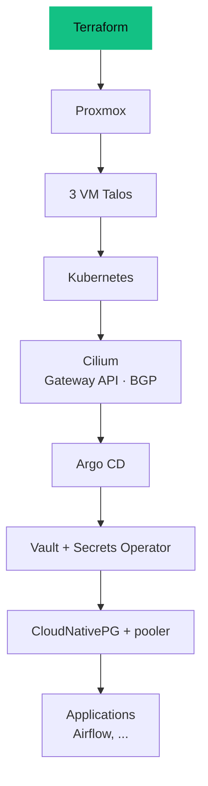

<Tldr>

- **Ce que c'est :** un cluster Talos à trois nœuds qui fait tourner Cilium, Argo CD, Vault, PostgreSQL, Longhorn, Airflow et Kafka.
- **Ce qui a cassé :** surtout des problèmes d'**ordre**, pas des bugs : chaque couche dépend de la précédente.
- **Ce qu'on en retient :** une plateforme est une chaîne de dépendances, et consigner chaque incident est la moitié du travail.
- **Cadrage honnête :** je le fais tourner pour apprendre ces outils, pas parce que tout nécessite Kubernetes : Docker ou une VM suffisent souvent.

</Tldr>

Je fais tourner un petit cluster Kubernetes à la maison, à côté du reste de mon homelab. C'est là que j'essaie les outils que je rencontre en data engineering — un orchestrateur, un bus de messages, un opérateur de base de données, du stockage objet — sur une infrastructure que je contrôle entièrement. Cet article est un tour de la façon dont elle est construite, et, plus utilement, de ce qui a mal tourné pendant que je la construisais.

<Callout tone="brand">Kubernetes est la plateforme que je rencontre en data engineering, et en ligne elle s'accompagne souvent d'une certaine crainte. Je voulais voir par moi-même pourquoi, et l'ajouter à ma palette, puisqu'elle fait partie de la stack moderne. La façon la plus rapide de la comprendre est d'en exploiter une, de la casser et de la réparer. La compétence que je veux n'est pas « utiliser Kubernetes partout » : c'est savoir **quand cela en vaut la peine, et quand non**. Docker sur une seule machine, voire une simple machine virtuelle, est souvent plus simple et largement suffisant. Tout ce qui suit vient de mes propres notes de déploiement : les échecs sont réels, et les corrections aussi.</Callout>

## Pourquoi Talos

Le cluster tourne sur **Talos Linux**, un système d'exploitation conçu uniquement pour faire tourner Kubernetes. Il n'y a ni SSH ni gestionnaire de paquets : un nœud est configuré par un fichier déclaratif et administré par une API. Cela correspondait à ce que je voulais, c'est-à-dire un cluster que je peux décrire dans Git et reconstruire, plutôt qu'un ensemble de machines que j'aurais bricolées à la main.

Trois machines virtuelles sur trois hôtes Proxmox forment le cluster, chacune avec 4 vCPU et 8 Go de mémoire. Chacune est à la fois un nœud control-plane et un worker.

## A-t-on vraiment besoin de Kubernetes ?

En général, non. Autant le dire clairement. Dans mon propre labo, plusieurs services (Immich, Portainer, un outil documentaire) tournent sur **un simple hôte Docker**, et c'est le bon choix pour eux : moins de choses à exploiter, moins de choses qui cassent. Une machine virtuelle suffit quand une seule machine suffit.

Je fais tourner Kubernetes à côté pour une autre raison : c'est la plateforme que je rencontre en data engineering, et la façon la plus rapide de la comprendre est d'en exploiter une, de la casser et de la réparer. La compétence que je veux n'est pas « utiliser Kubernetes partout », c'est **savoir quand cela en vaut la peine, et quand non**.

En ligne, certains ont peur de Kubernetes et le jugent trop compliqué, tandis que d'autres le poussent partout. Je préfère mettre les préjugés de côté et simplement essayer de comprendre : ce qu'il fait, comment il se comporte, comment il fonctionne. Il y a aussi une certaine beauté dans ce que l'outil sait faire, et cela fait partie de l'intérêt.

Mais je comprends parfaitement l'autre point de vue. Quand la question relève de la conception d'un système, une machine virtuelle a souvent bien plus de sens qu'un cluster pour simplement faire tourner un site web. Un cluster n'est pas gratuit : il faut l'administrer et gérer son cycle de vie, et si cela ne sert pas le besoin métier, il n'y a aucune raison d'aller dans cette voie.

## La pile en un coup d'œil

<Table
  data={{
    headers: [
      { content: "Couche", key: "layer" },
      { content: "Ce que j'utilise", key: "what" },
      { content: "À quoi ça sert", key: "for" }
    ],
    rows: [
      ["Réseau", "Cilium, Gateway API, BGP", "Réseau des pods, et un point d'entrée unique dont l'adresse est annoncée à mon routeur"],
      ["GitOps", "Argo CD", "Réconcilie en continu le cluster depuis le dépôt"],
      ["Secrets", "Vault (Raft) et le Vault Secrets Operator", "Aucun secret dans Git : les applications les reçoivent à l'exécution"],
      ["Bases de données", "CloudNativePG avec un pooler de connexions", "PostgreSQL pour les applications qui en ont besoin"],
      ["Stockage", "Longhorn", "Volumes persistants sur un disque dédié par nœud"],
      ["Stockage objet", "MinIO, distribué", "Stockage compatible S3"],
      ["Orchestration", "Apache Airflow", "Planification de pipelines de données, avec des DAG synchronisés depuis Git"],
      ["Messagerie", "Kafka, un seul broker", "Un bus de messages pour expérimenter le streaming"],
      ["Observabilité", "Prometheus, Grafana, Loki, Hubble", "Métriques, tableaux de bord, journaux et flux réseau"]
    ]
  }}
/>

## L'ordre compte

La chose la plus utile que m'a apprise le runbook, c'est qu'une plateforme Kubernetes est une **chaîne de dépendances**. Faite dans le mauvais ordre, chaque couche échoue de façon déroutante.



On dit à Talos de **ne pas** installer de plugin réseau, parce que Cilium doit être installé en premier et que tout le reste en dépend. Dans la configuration du nœud, cela tient en deux lignes :

```yaml
cluster:
  network:
    cni:
      name: none
  proxy:
    disabled: true
```

Argo CD vient après Cilium et prend le relais : à partir de là, Git est la source de vérité et je cherche à éviter les `kubectl apply` manuels.

## Stockage : de petites décisions, écrites

Chaque nœud Talos garde un petit disque système, et un **second disque est dédié à Longhorn**. J'ai défini deux classes de stockage :

- **une copie** pour les données déjà répliquées par l'application, ou que je peux me permettre de perdre : caches, journaux, supervision, MinIO distribué.
- **deux copies** pour les petites données critiques : PostgreSQL, Vault et Kafka.

La capacité brute est d'environ 450 Go, et le budget des volumes déclarés reste bien en dessous de ce que Longhorn peut réellement planifier. J'ai aussi évité d'empiler la réplication sur la réplication : MinIO distribué et le Raft de Vault gardent déjà leurs propres copies, donc ils n'en reçoivent pas une troisième de Longhorn. Et une réplique Longhorn n'est **pas une sauvegarde** — les vraies sauvegardes vont sur une machine séparée, en dehors du cluster.

## Ce qui a cassé, et ce que ça m'a appris

<Table
  data={{
    headers: [
      { content: "Symptôme", key: "sym" },
      { content: "Cause", key: "cause" },
      { content: "Leçon", key: "lesson" }
    ],
    rows: [
      ["Les nœuds ne démarraient pas", "Le type de CPU virtuel était trop ancien pour ce que Talos exige", "Utiliser le type de CPU de l'hôte — en acceptant que la migration à chaud entre CPU différents soit alors exclue"],
      ["Aucune VM n'avait d'adresse réseau", "Un tag VLAN appliqué deux fois : une fois par le port du switch, une fois par l'hyperviseur", "Choisir un seul endroit où taguer les VLAN, pas les deux"],
      ["Les objets Gateway étaient rejetés", "Les définitions de la Gateway API n'étaient pas encore installées", "Installer d'abord Cilium et les définitions, puis les routes, en étapes séparées"],
      ["Définitions de supervision refusées", "Certaines définitions de ressources Prometheus sont trop volumineuses pour la méthode d'application par défaut", "Les installer dans une étape à part, avant le chart qui les utilise"],
      ["Vault en boucle de plantage au démarrage", "Ses sondes de santé rejetaient l'état normal « scellé »", "Les sondes doivent accepter les états dans lesquels un service se trouve légitimement pendant l'amorçage"],
      ["Airflow bloqué en attendant les migrations", "Sous Argo CD, les hooks Helm qui créent les jobs de migration ne s'exécutaient jamais", "Désactiver les hooks et laisser Argo gérer ces jobs comme des ressources normales"],
      ["Airflow ne pouvait pas se connecter à sa base", "Vault avait été reconstruit après la base, donc le mot de passe stocké et le vrai avaient divergé", "Créer les secrets dans le bon ordre, et savoir exactement quoi renouveler quand l'un change"]
    ]
  }}
/>

La dernière est ma préférée, parce que ce n'est pas un bug d'un outil. Un rôle de base de données lit son mot de passe **une seule fois**, à sa création. Modifier le secret plus tard ne change pas le rôle. Le seul ordre sûr est : générer le mot de passe, le stocker dans Vault, laisser l'opérateur créer le secret Kubernetes, *puis* créer la base. Quand je me suis trompé dans l'ordre, j'ai dû réaligner le mot de passe du rôle à la main, puis redémarrer le pooler de connexions pour qu'il oublie les anciens identifiants gardés en mémoire.

## Ce que ça coûte à faire tourner

Un homelab a un coût de fonctionnement, et je le mesure. Mesuré à la prise, **le homelab entier** — les trois hôtes Proxmox, le NAS et le matériel réseau — consomme en moyenne environ **115 W**, soit environ **3 kWh par jour**, donc à peu près **90 kWh par mois**. Sur les neuf premiers jours de novembre 2026, la moyenne quotidienne était de 2,98 kWh, et le maximum quotidien de 3,1 kWh. C'est très stable d'un jour à l'autre.

## Ce que j'améliorerais

Les répliques Longhorn ne sont pas des sauvegardes. L'étape suivante est de pointer Longhorn vers une cible de sauvegarde sur ma machine TrueNAS, avec les identifiants stockés dans un secret chiffré et jamais dans Git, pour que les données du cluster soient sauvegardées en dehors du cluster.

## Les règles que je suis maintenant

- **Git est la source de vérité.** Une correction manuelle qui ne finit pas dans Git sera défaite par la prochaine synchronisation.
- **Ne jamais copier l'état, les secrets ou les kubeconfig.** Reconstruire en rejouant le dépôt dans l'ordre, puis restaurer les données depuis les sauvegardes.
- **Restaurer des données n'est pas reconstruire un cluster.** Ce sont deux étapes distinctes, volontairement.
- **Écrire l'incident pendant qu'il est frais.** La moitié de cet article est simplement mon runbook.

## Où ça en est

Le cluster tourne, et les services de plateforme ci-dessus sont déployés via Argo CD. C'est un environnement d'apprentissage, donc il change souvent. Le prochain manque que je veux combler est la couverture de sauvegarde des données qui vivent dans Longhorn.

**Mise à jour, 9 novembre 2026.** Les trois nœuds tournent maintenant depuis plus d'un mois, tous en bonne santé, avec le cluster sous Talos 1.13. Un cluster qui reste discrètement en ligne est le meilleur test de tout ce qui précède.

Si vous voulez l'autre moitié — comment sont créées les machines virtuelles sous le cluster — je l'ai écrite dans [Provisionner Proxmox avec Terraform et GitLab CI/CD](/fr/blog/proxmox-terraform-gitlab-ci).
