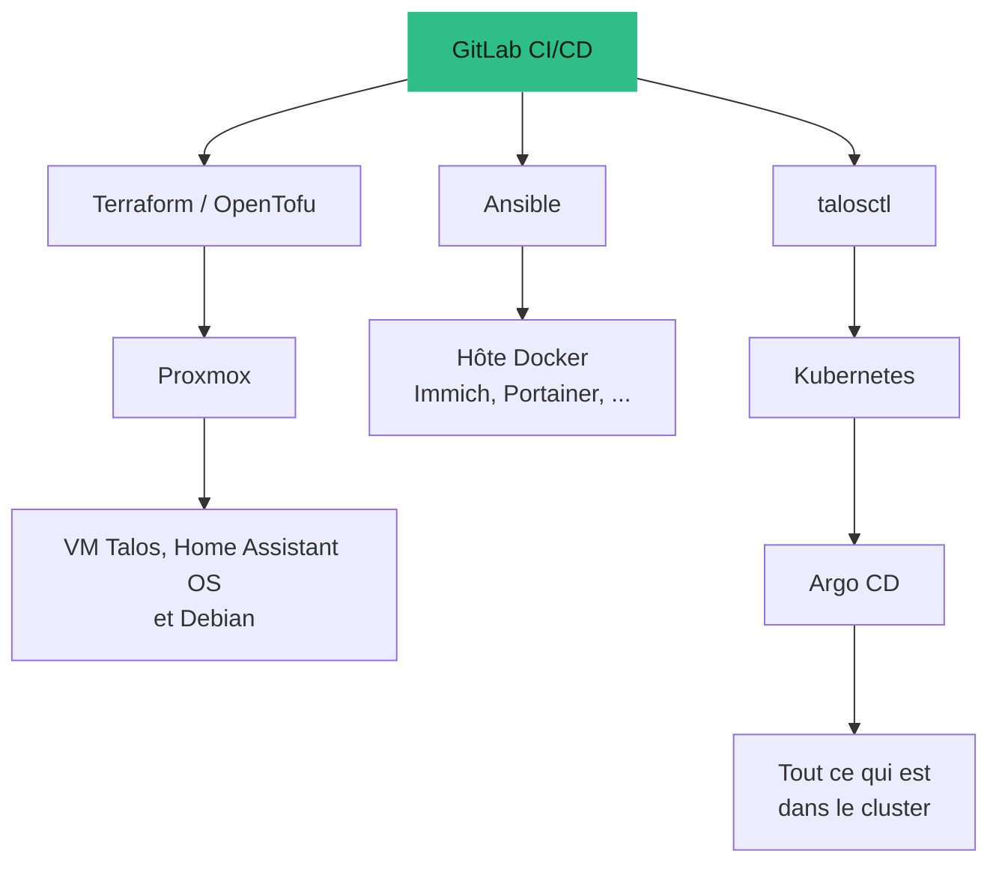
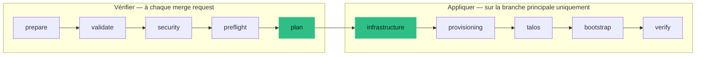

<Tldr>

- **Le problème :** des machines virtuelles créées à la main ne peuvent pas être reconstruites.
- **Ce que j'ai construit :** un pipeline GitLab qui vérifie, planifie et applique Terraform sur Proxmox, avec un module unique qui crée chaque VM.
- **Ce que j'ai appris :** épingler ses versions, taguer un VLAN à un seul endroit, et exécuter le pipeline depuis l'intérieur du réseau.

</Tldr>

Mon homelab tourne sur trois hôtes Proxmox. Je pouvais créer les machines virtuelles en cliquant dans l'interface web, et pendant un temps je l'ai fait. Puis j'ai voulu pouvoir tout reconstruire depuis un dépôt — alors **j'apprends Terraform**, et j'utilise un pipeline GitLab pour l'exécuter.

<Callout tone="brand">C'est un récit d'apprenti. L'installation fonctionne, mais la partie la plus précieuse est la liste de ce que j'ai d'abord mal fait.</Callout>

## L'idée

Le dépôt est l'unique source de vérité. Un changement d'infrastructure est une merge request : le pipeline la vérifie et montre un plan, et ce n'est qu'après la fusion dans la branche principale que quelque chose change réellement.



Chaque outil possède une couche. Terraform possède les **machines virtuelles** : leurs disques, leur réseau et leur dimensionnement. Il ne gère pas ce qui tourne à l'intérieur — Ansible configure l'hôte Docker, Talos se configure via sa propre API, et Argo CD prend le relais dans Kubernetes. Garder ces frontières claires est ce qui évite que les outils se battent entre eux.

## Un module, cinq machines

Chaque machine virtuelle est créée par le même petit **module** Terraform, donc toutes suivent le même modèle. Le module étiquette automatiquement chaque machine `managed` et `iac`, puis ajoute des étiquettes pour son rôle. Dans l'interface Proxmox, je vois ainsi d'un coup d'œil quelles machines appartiennent au code, et lesquelles seraient une exception faite à la main.

<Table
  data={{
    headers: [
      { content: "Machine", key: "vm" },
      { content: "Taille", key: "size" },
      { content: "Rôle", key: "role" }
    ],
    rows: [
      ["Trois nœuds Talos, un sur chaque hôte Proxmox", "4 vCPU, 8 Go de mémoire chacun", "Les nœuds control-plane Kubernetes, utilisés aussi comme workers"],
      ["Home Assistant OS", "2 vCPU, 5 Go de mémoire", "Domotique"],
      ["Un hôte Docker Debian", "4 vCPU, 8 Go de mémoire", "Immich, Portainer et un outil documentaire"]
    ]
  }}
/>

Voici le cœur de ce module. Notez les étiquettes, ajoutées à chaque machine, et la description qui indique à quiconque ouvre la machine dans Proxmox qu'elle n'est pas faite pour être modifiée à la main :

```hcl
resource "proxmox_virtual_environment_vm" "this" {
  name        = var.name
  node_name   = var.node_name
  vm_id       = var.vm_id
  description = "Managed exclusively by Terraform"
  tags        = concat(["managed", "iac"], var.tags)

  cpu {
    cores = var.cores
    type  = var.cpu_type
  }

  memory {
    dedicated = var.memory_mb
  }
  # ... disks, network and cloud-init follow
}
```

## Le pipeline



<Table
  data={{
    headers: [
      { content: "Étape", key: "stage" },
      { content: "Ce qui se passe", key: "what" }
    ],
    rows: [
      ["prepare", "Télécharge les images des systèmes d'exploitation et vérifie leurs sommes de contrôle ; les images déjà stockées sont réutilisées, donc l'étape est sans risque à répéter"],
      ["validate", "Analyse le YAML, les charts Helm, les playbooks Ansible et les manifestes Kubernetes"],
      ["security", "Cherche des secrets dans le dépôt avant que quoi que ce soit d'autre s'exécute"],
      ["preflight", "Vérifie que Proxmox est joignable et prêt"],
      ["plan", "Montre ce que Terraform changerait"],
      ["infrastructure", "Applique le plan : crée les VM, le stockage NFS de sauvegarde et la tâche de sauvegarde planifiée"],
      ["provisioning", "Configure l'hôte Docker avec Ansible"],
      ["talos / bootstrap", "Démarre Kubernetes, puis passe la main à Argo CD"],
      ["verify", "Vérifie que le résultat est sain"]
    ]
  }}
/>

Le pipeline s'arrête au premier échec : aucune étape suivante ne s'exécute tant que la précédente n'est pas verte. Les merge requests ne changent jamais l'infrastructure — elles ne font que planifier.

## Les décisions qui ont compté

- **État distant, avec verrou.** L'état Terraform vit dans GitLab, et il est verrouillé pendant qu'un job tourne, donc deux pipelines ne peuvent pas modifier la même infrastructure en même temps.
- **Un runner sur mon propre réseau.** Proxmox et les VM ne sont pas joignables depuis Internet. Un runner hébergé ne peut pas les voir, donc les jobs tournent sur un runner local qui le peut.
- **Les secrets restent hors du dépôt.** Les identifiants vivent dans des variables CI protégées et masquées. Le compte Proxmox utilisé par Terraform est un compte dédié avec seulement les droits nécessaires, jamais le compte root.
- **Versions et sommes de contrôle épinglées.** Le provider Proxmox est épinglé sur une version exacte, et les images sont épinglées et vérifiées. Quelque chose qui change en silence sous mes pieds est pire que quelque chose d'un peu ancien.
- **L'humain garde la main sur les parties risquées.** L'amorçage de Talos et de GitOps sont des étapes volontaires, pas quelque chose qui se produit à chaque push.

## Ce que j'ai mal fait

<Table
  data={{
    headers: [
      { content: "Erreur", key: "mistake" },
      { content: "Ce que j'ai appris", key: "learnt" }
    ],
    rows: [
      ["Le pipeline ne pouvait pas joindre l'hyperviseur", "Un runner CI hébergé n'a pas de route vers un réseau privé. Utilisez un runner local."],
      ["Terraform ne trouvait pas le provider Proxmox", "Chaque module doit déclarer le provider qu'il utilise, pas seulement le module racine."],
      ["Aucune VM n'avait d'adresse réseau", "J'ai tagué le VLAN deux fois, sur le port du switch et sur la VM. Il faut en choisir un."],
      ["Talos ne démarrait pas", "Le CPU virtuel par défaut est trop ancien. Le type de CPU « host » règle le problème, avec une contrepartie sur la migration à chaud."],
      ["Confusion sur l'état", "Les sorties de Terraform sont les adresses que j'ai demandées, pas les adresses que les machines ont réellement."]
    ]
  }}
/>

## Un petit détail que j'aime : des sauvegardes qui se gèrent toutes seules

Une tâche planifiée sur un nœud Proxmox allume ma machine TrueNAS via son contrôleur de gestion, attend les partages de fichiers, sauvegarde les VM des trois nœuds, lance une sauvegarde Time Machine pour mon Mac, puis demande au NAS de s'éteindre proprement. En cas d'échec, elle s'arrête et **laisse le NAS allumé**, plutôt que de couper le courant en plein travail. J'ai conçu le cas d'échec en premier. L'histoire complète, avec le matériel, est dans [Des sauvegardes de confiance : un HP MicroServer, iLO et TrueNAS](/fr/blog/backups-microserver-truenas-ilo).

## Ce que j'améliorerais

- **Décrire aussi le réseau en code.** Les entrées DNS dont dépend mon cluster vivent dans le contrôleur UniFi, pas dans le dépôt. C'est une dépendance manuelle qui devrait être déclarée quelque part où on peut la relire.
- **Protéger l'état Terraform.** Il vit dans GitLab. S'il était perdu, le plan de reprise serait d'importer les ressources existantes ou d'accepter une reconstruction à vide. Un export régulier de l'état rendrait cela bien moins pénible.
- **Garder les secrets Talos hors de Git, mais en sécurité.** Ils doivent rester identiques pendant toute la vie du cluster, et ils sont stockés comme un fichier CI protégé. Les perdre veut dire un nouveau cluster.

## Où ça en est

C'est un travail en cours, et je le traite comme mon terrain d'entraînement à l'infrastructure as code. Si le matériel disparaissait demain, le plan est de restaurer Proxmox et le réseau à la main, puis de rejouer le pipeline pour recréer les machines virtuelles, et de restaurer les données depuis les sauvegardes.

L'autre moitié de l'histoire — ce qui tourne sur le cluster que forment ces VM — est dans [Faire tourner Kubernetes à la maison avec Talos](/fr/blog/kubernetes-talos-homelab).
