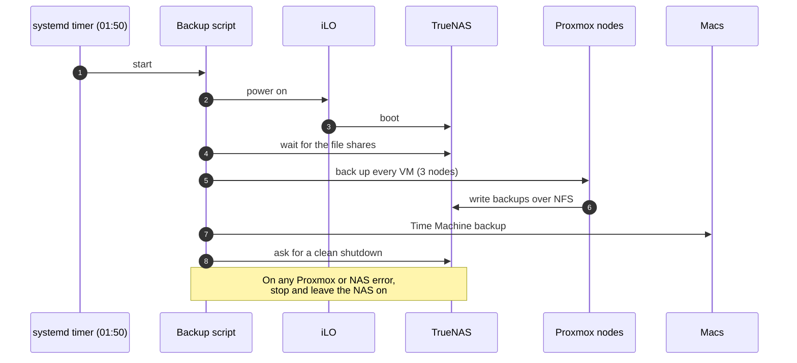

<Tldr>

- **What:** a second-hand HP MicroServer Gen8 turned into a backup NAS running TrueNAS, woken every night at 1:50 a.m.
- **Key ideas:** iLO lets me power it on remotely, and the script leaves the NAS on if anything goes wrong.
- **Missing:** an off-site copy.

</Tldr>

Self-hosting my own data only makes sense if I can restore it. So the first thing I built around my homelab was not a service, but a **backup machine**: a small HP server running TrueNAS, woken up every night to do its job and then put back to sleep.

<Callout tone="brand">I did not invent the hardware part. I followed a written guide and two videos (all credited below), then built the automation on top. This article is my version of the story.</Callout>

## The machine: HP MicroServer Gen8

The HP MicroServer Gen8 is a small, quiet server from HP's ProLiant family, easy to find second-hand. It has four hard-drive bays, two network ports and — the feature that matters most to me — a dedicated management port for **iLO**.

### Why iLO matters

iLO (*Integrated Lights-Out*) is a management controller built into the server. It is a tiny computer inside the computer, reachable on its own network port **even when the server is switched off**. It lets me:

- open a remote console, as if a screen were plugged in, so I never need a monitor;
- switch the server on, off or reset it, from a web page or a command line.

For a backup machine that is exactly what I want. The NAS does not need to run all day. With iLO, something else can power it on when needed, and I can always reach it — even if the operating system is broken.

## Swapping the optical drive for an SSD

The server has a CD/DVD drive bay that nobody needs any more. I replaced the drive with an adapter holding a **2.5-inch SSD**. That gives the operating system its own disk, and keeps all four bays free for data.

### Powering the SSD: cut the cable, bridge the power supply

The SSD needs power as well as data, and the optical drive's power connector is not the usual SATA one. In my case it meant a bit of manual work: **I had to cut the optical drive's cable and make a bridge to the server's power supply** to feed the SSD from it. It is the least elegant step of the whole project, and the one that needs the most care.

<Callout tone="critical">Only do this with the server **unplugged** from the mains. Cutting and splicing a power cable is a hardware modification: check every connection twice before powering the machine back on, and do it at your own risk.</Callout>

### Getting it to boot (the hard part)

This is where it stopped being easy. By default, the Gen8 only boots from its microSD slot or from one of the four main bays — **not** from a drive in the optical bay. Putting the SSD there is not enough.

The fix is to declare the SSD to the server's storage controller as a one-disk volume, using HPE's Smart Storage tool, and then mark that volume as the **primary boot volume**. From then on the server boots from the SSD. The hard part was not the doing, it was **finding out how**: nothing in the machine hints that this is possible, and the answer is spread across forum posts, a written guide and a couple of videos. Once I knew the exact procedure, the steps themselves are short — and they are done from the firmware screens, through the iLO remote console, so I never needed a monitor.

## Upgrading the processor and the memory

A NAS that runs ZFS benefits from a bit more power and from **ECC memory**, which detects and corrects memory errors, the usual recommendation for a ZFS-based machine. So I upgraded the server:

<Table
  data={{
    headers: [
      { content: "Part", key: "part" },
      { content: "Now", key: "now" }
    ],
    rows: [
      ["Processor", "Intel Xeon E3-1265L v2, 2.50 GHz"],
      ["Memory", "2 × 8 GB DDR3 ECC"]
    ]
  }}
/>

The Xeon "L" processors are the low-power versions, which suits a machine that is meant to stay quiet and cheap to run.

## TrueNAS and the storage pool

With the OS disk sorted, I installed **TrueNAS SCALE** and set up the storage pool. The four bays hold **four disks, two of 4 TB and two of 3 TB, which give about 7 TB of usable space** in total. I split them into **two pools**: one only for the **Time Machine** backups of my Macs, and one for **all the other backups**, including the Proxmox virtual machines. Keeping them apart has a practical benefit: Time Machine grows to fill whatever space it is given, so it cannot starve the other backups. The part I care about most is *how the backups are exposed*:

- a **dedicated dataset** for Proxmox backups, never the root of the pool, so the share can only touch what it should;
- a **dedicated user and group** that own that dataset;
- an **NFS share** restricted to the addresses of my three Proxmox nodes only.

Proxmox sees it as a storage target. A daily backup job, defined in Terraform like the rest of my infrastructure, backs up every virtual machine in snapshot mode, compressed, and keeps the last 7 backups plus 4 weekly and 6 monthly ones:

```hcl
resource "proxmox_backup_job" "truenas_daily" {
  schedule = "*-*-* 02:00"
  all      = true
  mode     = "snapshot"
  compress = "zstd"

  prune_backups = {
    "keep-last"    = "7"
    "keep-weekly"  = "4"
    "keep-monthly" = "6"
  }
}
```

When the 1:50 script is in charge, this built-in job is switched off, so a backup does not run twice.

## The 1:50 a.m. script

A machine that runs 24 hours a day just to be backed up to for a few minutes wastes power. So the NAS is **off most of the time**, and a small script wakes it up.



The whole nightly run takes about **an hour**, give or take, depending on how much has changed since the day before. That is why it starts at 1:50: it is long finished before I am awake.

The script lives in my homelab repository and is deployed by the same pipeline as everything else, so nothing is configured by hand on the Proxmox node. The schedule itself is a small systemd timer:

```ini
[Timer]
OnCalendar=*-*-* 01:50:00
Persistent=true
Unit=nas-backup-orchestrator.service
```

`Persistent=true` means that if the Proxmox node was off at 1:50, the job runs as soon as it comes back, instead of being silently skipped.

### Designing for failure

The interesting part is what the script does when something goes wrong:

- If a **Proxmox or NAS error** occurs, it stops and **leaves the NAS powered on**. I prefer a machine that stays on to one that is cut off in the middle of a write.
- If a **Mac is asleep**, it retries for a minute, logs a warning and carries on with the others.
- A **dry-run mode** tests the connections without backing up or shutting anything down.
- It never uses iLO to switch the NAS off: shutdown goes through a proper request to TrueNAS, so the pool is closed cleanly.

### A dedicated iLO account

The script does not log in to iLO as an administrator. I created a dedicated account with only three rights: virtual power and reset, remote console access and virtual media. If its credentials ever leaked, it could do very little. That is a habit I want to keep: **every automation gets its own account with the minimum it needs**.

## What this does not give me

This is a backup in the same house as the originals. It protects against a failed disk, a deleted VM or a bad change; it does **not** protect against fire, theft or a power surge that kills both machines. An off-site copy is the missing piece, and it is on my list.

I also test restores. A backup that has never been restored is only a hope.

## Credits

The hardware preparation — iLO, swapping the optical drive for a disk and declaring it bootable — follows McFly's guide, [HP MicroServer Gen8 — Mise en service et installation d'un OS](https://mcflypartages.fr/blog/hp_gen_8_mise_en_place/) on McFlyPartages (in French). It is a clear, practical walkthrough, and I recommend it if you want to do the same.

Two videos also helped me:

- [HP Proliant Microserver Gen8 SSD in Optical bay](https://www.youtube.com/watch?v=co8wuIUpDJc) by No Tech Drama, for the SSD in the optical bay.
- [Upgrading HP Proliant Gen8 Microserver (Part 1) — Performance](https://youtu.be/-nWmb2GdqHc) by AnChan Tech, for the processor and memory upgrade.

The way this fits with the rest of my lab is described in [Provisioning Proxmox with Terraform and GitLab CI/CD](/blog/proxmox-terraform-gitlab-ci).
