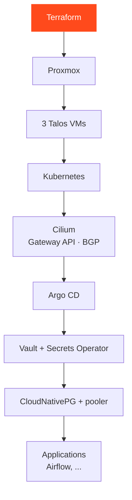

<Tldr>

- **What it is:** a three-node Talos cluster running Cilium, Argo CD, Vault, PostgreSQL, Longhorn, Airflow and Kafka.
- **What broke:** mostly **ordering** problems, not bugs: each layer depends on the one before it.
- **Takeaway:** a platform is a dependency chain, and writing every incident down is half the work.

</Tldr>

I run a small Kubernetes cluster at home, next to the rest of my homelab. It is where I try the tools I meet in data engineering — an orchestrator, a message broker, a database operator, object storage — on infrastructure I fully control. This article is a tour of how it is put together, and, more usefully, of what went wrong while I built it.

<Callout tone="brand">I am still learning. Everything below comes from my own deployment notes: the failures are real, and so are the fixes.</Callout>

## Why Talos

The cluster runs on **Talos Linux**, an operating system built only to run Kubernetes. There is no SSH and no package manager: a node is configured by a declarative file and administered through an API. That suited what I wanted, which is a cluster I can describe in Git and rebuild, instead of a set of machines I have tweaked by hand.

Three virtual machines on three Proxmox hosts form the cluster, each with 4 vCPUs and 8 GB of memory. Each one is both a control-plane node and a worker.

## The stack at a glance

<Table
  data={{
    headers: [
      { content: "Layer", key: "layer" },
      { content: "What I use", key: "what" },
      { content: "What it is for", key: "for" }
    ],
    rows: [
      ["Networking", "Cilium, Gateway API, BGP", "Pod networking, and a single entry point whose address is announced to my router"],
      ["GitOps", "Argo CD", "Continuously reconciles the cluster from the repository"],
      ["Secrets", "Vault (Raft) and the Vault Secrets Operator", "No secret in Git: applications receive them at runtime"],
      ["Databases", "CloudNativePG with a connection pooler", "PostgreSQL for the applications that need one"],
      ["Storage", "Longhorn", "Persistent volumes on a dedicated disk per node"],
      ["Object storage", "MinIO, distributed", "S3-compatible storage"],
      ["Orchestration", "Apache Airflow", "Scheduling data pipelines, with DAGs synced from Git"],
      ["Messaging", "Kafka, a single broker", "A message bus to experiment with streaming"],
      ["Observability", "Prometheus, Grafana, Loki, Hubble", "Metrics, dashboards, logs and network flows"]
    ]
  }}
/>

## Order matters

The most useful thing the runbook taught me is that a Kubernetes platform is a **dependency chain**. Done in the wrong order, each layer fails in a confusing way.



Talos is told **not** to install a network plugin, because Cilium has to be installed first and everything else depends on it. In the node configuration, that is two lines:

```yaml
cluster:
  network:
    cni:
      name: none
  proxy:
    disabled: true
```

 Argo CD comes after Cilium, and takes over from there: from that point, Git is the source of truth and manual `kubectl apply` is something I try to avoid.

## Storage: small decisions, written down

Each Talos node keeps a small system disk, and a **second disk is dedicated to Longhorn**. I defined two storage classes:

- **single copy** for data that is already replicated by the application, or that I can afford to lose: caches, logs, monitoring, distributed MinIO.
- **two copies** for small, critical data: PostgreSQL, Vault and Kafka.

The raw capacity is about 450 GB, and the budget of declared volumes stays well under what Longhorn can actually schedule. I also avoided stacking replication on replication: distributed MinIO and Vault's Raft already keep their own copies, so they do not get a third one from Longhorn. And a Longhorn replica is **not a backup** — real backups go to a separate machine outside the cluster.

## What broke, and what it taught me

<Table
  data={{
    headers: [
      { content: "Symptom", key: "sym" },
      { content: "Cause", key: "cause" },
      { content: "Lesson", key: "lesson" }
    ],
    rows: [
      ["Nodes would not start", "The virtual CPU type was too old for what Talos needs", "Use the host CPU type — and accept that live migration between different CPUs is then off the table"],
      ["Every VM had no network address", "A VLAN tag applied twice: once by the switch port, once by the hypervisor", "Choose one place to tag VLANs, not both"],
      ["Gateway objects were rejected", "The Gateway API definitions were not installed yet", "Install Cilium and the definitions first, then the routes, as separate steps"],
      ["Monitoring definitions refused", "Some Prometheus resource definitions are too large for the default apply method", "Install them in their own step, before the chart that uses them"],
      ["Vault crash-looping at start-up", "Its health probes rejected the normal sealed state", "Probes must accept the states a service is legitimately in during bootstrap"],
      ["Airflow stuck waiting for migrations", "Under Argo CD, the Helm hooks that create the migration jobs never ran", "Turn the hooks off and let Argo manage those jobs as normal resources"],
      ["Airflow could not log in to its database", "Vault was rebuilt after the database, so the stored password and the real one had diverged", "Create secrets in the right order, and know exactly what to rotate when one changes"]
    ]
  }}
/>

The last one is my favourite, because it is not a bug in any tool. A database role reads its password **once**, when it is created. Changing the secret later does not change the role. The only safe order is: generate the password, store it in Vault, let the operator create the Kubernetes secret, *then* create the database. When I got it wrong, fixing it meant aligning the role by hand and restarting the pooler to clear its cached credentials.

## What it costs to run

A homelab has a running cost, and I measure it. On the plug that feeds my lab, the average draw is about **115 W**, which is about **3 kWh a day**, so roughly **90 kWh a month**. For the first nine days of November 2026 the daily average was 2.98 kWh, and the daily maximum 3.1 kWh. The consumption is very steady, which is what you would expect from machines that are always on.

## What I would improve

Longhorn replicas are not backups. The next step is to point Longhorn at a backup target on my TrueNAS machine, with the credentials stored as an encrypted secret and never in Git, so that the data in the cluster is backed up outside the cluster.

## Rules I now follow

- **Git is the source of truth.** A manual fix that does not end up in Git will be undone by the next sync.
- **Never copy state, secrets or kubeconfigs around.** Rebuild by replaying the repository in order, then restore data from backups.
- **Restoring data is not rebuilding a cluster.** They are two separate steps, on purpose.
- **Write the incident down while it is fresh.** Half of this article is simply my runbook.

## Where it stands

The cluster runs, and the platform services above are deployed through Argo CD. It is a learning environment, so it changes often. The next gap I want to close is backup coverage for the data that lives in Longhorn.

**Update, 9 November 2026.** The three nodes have now been up for over a month, all reporting healthy, with the cluster running Talos 1.13. A cluster that quietly stays up is the best test of everything above.

If you want the other half — how the virtual machines under the cluster get created — I wrote it up in [Provisioning Proxmox with Terraform and GitLab CI/CD](/blog/proxmox-terraform-gitlab-ci).
