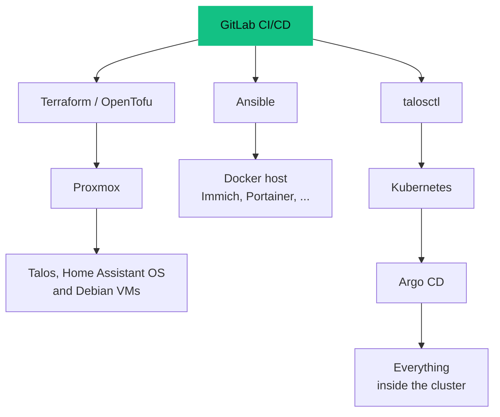
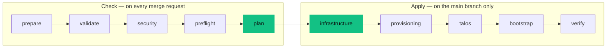

<Tldr>

- **The problem:** virtual machines created by hand cannot be rebuilt.
- **What I built:** a GitLab pipeline that checks, plans and applies Terraform on Proxmox, with one module that creates every VM.
- **What I learnt:** pin your versions, tag a VLAN in one place only, and run the pipeline from inside the network.

</Tldr>

My homelab runs on three Proxmox hosts. I could create the virtual machines by clicking through the web interface, and for a while I did. Then I wanted to be able to rebuild everything from a repository — so I am **learning Terraform**, and I use a GitLab pipeline to run it.

<Callout tone="brand">This is a learner's account. The setup works, but the most valuable part is the list of things I got wrong first.</Callout>

## The idea

The repository is the single source of truth. A change to the infrastructure is a merge request: the pipeline checks it and shows a plan, and only after merging into the main branch does anything actually change.



Each tool owns one layer. Terraform owns the **virtual machines**: their disks, their network and their sizing. It does not manage what runs inside them — Ansible configures the Docker host, Talos is configured through its own API, and Argo CD takes over inside Kubernetes. Keeping those boundaries clear is what stops the tools from fighting each other.

## One module, five machines

Every virtual machine is created by the same small Terraform **module**, so they all follow the same pattern. The module automatically tags each machine `managed` and `iac`, then adds tags for its role. In the Proxmox interface, that means I can see at a glance which machines belong to code, and which would be a hand-made exception.

<Table
  data={{
    headers: [
      { content: "Machine", key: "vm" },
      { content: "Size", key: "size" },
      { content: "Role", key: "role" }
    ],
    rows: [
      ["Three Talos nodes, one on each Proxmox host", "4 vCPUs, 8 GB of memory each", "The Kubernetes control-plane nodes, also used as workers"],
      ["Home Assistant OS", "2 vCPUs, 5 GB of memory", "Home automation"],
      ["A Debian Docker host", "4 vCPUs, 8 GB of memory", "Immich, Portainer and a document tool"]
    ]
  }}
/>

Here is the core of that module. Note the tags, which are added to every machine, and the description that tells anyone opening the machine in Proxmox that it is not meant to be edited by hand:

```hcl
resource "proxmox_virtual_environment_vm" "this" {
  name        = var.name
  node_name   = var.node_name
  vm_id       = var.vm_id
  description = "Managed exclusively by Terraform"
  tags        = concat(["managed", "iac"], var.tags)

  cpu {
    cores = var.cores
    type  = var.cpu_type
  }

  memory {
    dedicated = var.memory_mb
  }
  # ... disks, network and cloud-init follow
}
```

## The pipeline



<Table
  data={{
    headers: [
      { content: "Stage", key: "stage" },
      { content: "What happens", key: "what" }
    ],
    rows: [
      ["prepare", "Downloads the operating-system images and checks their checksums; images already stored are reused, so the step is safe to repeat"],
      ["validate", "Lints the YAML, Helm charts, Ansible playbooks and Kubernetes manifests"],
      ["security", "Scans the repository for secrets before anything else runs"],
      ["preflight", "Checks that Proxmox is reachable and ready"],
      ["plan", "Shows what Terraform would change"],
      ["infrastructure", "Applies the plan: creates the VMs, the NFS backup storage and the scheduled backup job"],
      ["provisioning", "Configures the Docker host with Ansible"],
      ["talos / bootstrap", "Brings up Kubernetes, then hands over to Argo CD"],
      ["verify", "Checks that the result is healthy"]
    ]
  }}
/>

The pipeline stops at the first failure: no later stage runs until the previous one is green. Merge requests never change the infrastructure — they only plan.

## Decisions that mattered

- **Remote state, with locking.** The Terraform state lives in GitLab, and is locked while a job runs, so two pipelines cannot change the same infrastructure at once.
- **A runner on my own network.** Proxmox and the VMs are not reachable from the internet. A hosted runner cannot see them, so jobs run on a local runner that can.
- **Secrets stay out of the repository.** Credentials live in protected, masked CI variables. The Proxmox account used by Terraform is a dedicated one with only the rights it needs, never the root account.
- **Pinned versions and checksums.** The Proxmox provider is pinned to an exact version, and images are pinned and verified. Something that silently changes under me is worse than something slightly old.
- **Humans in the loop for the risky parts.** Bootstrapping Talos and GitOps are deliberate steps, not something that happens on every push.

## What I got wrong

<Table
  data={{
    headers: [
      { content: "Mistake", key: "mistake" },
      { content: "What I learnt", key: "learnt" }
    ],
    rows: [
      ["The pipeline could not reach the hypervisor", "A hosted CI runner has no route to a private network. Use a local runner."],
      ["Terraform could not find the Proxmox provider", "Every module must declare the provider it uses, not just the root one."],
      ["No VM had a network address", "I tagged the VLAN twice, on the switch port and on the VM. Pick one."],
      ["Talos would not boot", "The default virtual CPU is too old. The host CPU type fixes it, with a trade-off on live migration."],
      ["State confusion", "Terraform's outputs are the addresses I asked for, not the addresses the machines actually have."]
    ]
  }}
/>

## A small thing I like: backups that look after themselves

A scheduled job on one Proxmox node powers on my TrueNAS machine through its management controller, waits for the file shares, backs up the VMs of all three nodes, starts a Time Machine backup for my Mac, and then asks the NAS to shut down cleanly. If something fails, it stops and **leaves the NAS on**, rather than cutting power mid-task. I designed the failure case first. The full story, with the hardware, is in [Backups I can trust: a HP MicroServer, iLO and TrueNAS](/blog/backups-microserver-truenas-ilo).

## What I would improve

- **Describe the network as code too.** The DNS entries my cluster depends on live in the UniFi controller, not in the repository. They are a manual dependency that should be declared somewhere reviewable.
- **Protect the Terraform state.** It lives in GitLab. If it were lost, the recovery plan is to import the existing resources or accept a rebuild from empty. A regular export of the state would make that much less painful.
- **Keep the Talos secrets outside Git, but safe.** They must stay identical for the whole life of the cluster, and they are stored as a protected CI file. Losing them means a new cluster.

## Where it stands

This is a work in progress, and I treat it as my training ground for infrastructure as code. If the hardware disappeared tomorrow, the plan is to restore Proxmox and the network by hand, then replay the pipeline to recreate the virtual machines, and restore the data from backups.

The other half of the story — what runs on the cluster those VMs form — is in [Running Kubernetes at home with Talos](/blog/kubernetes-talos-homelab).
