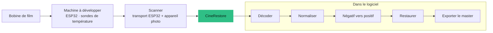

## Comment je suis venu à la pellicule

Tout a commencé quand quelqu'un m'a parlé de son intérêt pour la photo argentique, et je suis tombé dedans : j'ai commencé à collectionner des appareils et à lire tout ce que je trouvais sur le sujet.

## Pourquoi construire les machines

Les machines entièrement automatiques du commerce coûtent cher. Construire les miennes est un défi : faire mieux, et pour moins cher. Comme je sais aussi développer, ce projet est une fusion de tout ce que je fais. Je suis de près ce qui se fait en open source, et cela me fait gagner beaucoup de temps.

Je fais aussi CineRestore pour les membres de mon association photo et pour les débutants en photo argentique : un logiciel tout-en-un qui les aide à se lancer et à suivre toute la vie d'une pellicule. La photo argentique et le film de cinéma (Super 8 et formats voisins) se recoupent, et le logiciel passe en premier parce que j'en ai besoin pour piloter les machines que je construirai ensuite.

## Pourquoi ce projet existe

Je photographie et je développe de la pellicule argentique. Chaque étape — développement, numérisation, nettoyage des poussières et des rayures — vit généralement dans un outil différent, sans trace de ce qui a été fait à une image. CineRestore met tout le parcours au même endroit et le garde **traçable** : chaque photogramme sait de quelle bobine il vient, comment il a été capturé et ce qui a été modifié.

Il s'arrête volontairement là où commence le travail créatif. Il prépare un master neutre et laisse le montage et l'étalonnage aux outils faits pour cela.

<Callout tone="brand">Trois responsabilités, rien de plus : acquérir chaque photogramme sans perte, corriger les défauts techniques du scan et de la pellicule, et livrer un master dont la couleur, la cadence et la provenance sont explicitement décrites.</Callout>

## Trois machines, un seul programme — toutes en développement

<Table
  data={{
    headers: [
      { content: "Machine", key: "machine" },
      { content: "Ce qu'elle fait", key: "does" },
      { content: "Comment elle est conçue", key: "how" },
      { content: "Où elle en est", key: "stand" }
    ],
    rows: [
      ["Scanner photo 120/135", "Fait avancer une bande de film photogramme par photogramme pendant qu'un appareil photo capture chaque vue", "Transport à un moteur piloté par un ESP32 ; protocole série avec accusés de réception ; l'appareil est déclenché et le fichier attendu jusqu'à ce qu'il soit stable", "Firmware et code de contrôle écrits ; pas encore validé sur la vraie machine"],
      ["Machine à développer (« Lab »)", "Exécute une recette de développement : prélavage, révélateur, arrêt, fixateur, lavage — avec durée, agitation et température", "Firmware ESP32, sonde de température PT100 via un amplificateur MAX31865, pilote de moteur pas à pas, un watchdog, et des recettes envoyées avec des commandes acquittées", "Firmware et plan de câblage écrits ; câblage et essais thermiques à faire"],
      ["Scanner cinéma 8/16/35 mm", "Numérise de la pellicule cinéma une image à la fois", "Mécanique inspirée du scanner open source Gugusse, un transport séparé avec son propre protocole, capture RAW depuis une caméra Raspberry Pi", "Au stade de la conception : logiciel de contrôle et proposition d'électronique existent ; le banc physique reste à construire"]
    ]
  }}
/>

Le scanner cinéma part du modèle mécanique de [Gugusse](https://www.deniscarl.com/dokuwiki/doku.php), un scanner de film open source de Denis Carl. Le module de contrôle de CineRestore est ma propre implémentation ; la mécanique est sa référence.

## Le logiciel

<Table
  data={{
    headers: [
      { content: "Partie", key: "part" },
      { content: "Technologie", key: "tech" },
      { content: "Rôle", key: "role" }
    ],
    rows: [
      ["Moteur", "Workspace Rust (imagerie, scan, lab, film, export, persistance)", "Décodage, conversion négatif vers positif, restauration, gestion de la couleur et export"],
      ["Application", "Tauri 2 + React/TypeScript, avec un design system Storybook", "Quatre étapes dans une fenêtre : recette, développement, numérisation, restauration"],
      ["Firmware", "Sketchs ESP32 pour le transport du scanner et la machine à développer", "Contrôle temps réel des moteurs, résistances chauffantes et capteurs"],
      ["Couleur", "Décodage RAW, profils ICC, procédures de caractérisation ArgyllCMS", "Une couleur neutre et mesurable à partir d'un capteur d'appareil photo"],
      ["Export vidéo", "FFmpeg compilé depuis une source épinglée et embarqué dans l'application", "Sortie ProRes/H.264 pour les séquences de film, avec détection des images manquantes ou en double"],
      ["Livraison", "CI produisant une image disque macOS signée", "Contrôles Rust, interface, gel d'architecture et licences à chaque changement"]
    ]
  }}
/>

<Media
  src="/images/projects/cinerestore/dev-darkroom.jpg"
  alt="Maquette d'interface : l'étape de développement, avec minuteur, sondes de température et protocole"
  aspectRatio="16/10"
/>

<Media
  src="/images/projects/cinerestore/scan.jpg"
  alt="Maquette d'interface : l'étape de numérisation, préparant une session de capture pour une bobine de 36 vues"
  aspectRatio="16/10"
/>

*Les images sont des maquettes d'interface que l'application est construite pour respecter (affichées avec des données d'exemple) ; la couverture ci-dessus est l'étape de restauration.*

## Choix d'ingénierie

- **La donnée d'abord.** Chaque bobine, photogramme, recette et session est persistée et peut reprendre après une interruption ; les vues manquantes et en double sont détectées.
- **Une seule autorité par sujet.** Un contrôle de gel d'architecture en CI refuse un deuxième moteur concurrent de RAW, ICC ou couleur, sauf cas réel justifié.
- **Pipeline typé.** Le décodage, la normalisation technique, la conversion du négatif, la restauration et l'export sont des étapes typées et séparées, avec un seul contrat d'entrée d'image.
- **Sécurité sur les chemins matériels.** La machine à développer a un watchdog, et les commandes qui changent l'état attendent un accusé de réception avant que l'interface y croie.

## Où il en est, honnêtement

Le dépôt tient un rapport de validation qui sépare ce qui est *codé et testé en logiciel* de ce qui demande encore du *vrai matériel*. Dans sa version du 1er novembre 2026 :

- **Les contrôles logiciels passent.** La suite de tests Rust passe (818 tests, dont 29 volontairement ignorés car ils demandent des fichiers RAW privés ou une vraie bobine), et l'interface se compile.
- **Le décodage d'image est vérifié sur trois types de source** — un DNG Bayer d'un Ricoh GR III, un RAF X-Trans de Fujifilm et un fichier Cintel CRI — chacun contre une empreinte épinglée. Cela valide les décodeurs sur des fichiers représentatifs, pas une bobine physique complète.
- **L'alignement multicanal est testé** sur des images synthétiques (rouge, vert, bleu et infrarouge), et le contrôle qualité détecte désormais l'écrêtage qui touche un seul canal de couleur.

Ce qui reste bloqué par le matériel : une bobine réelle complète, le scanner photo (il n'était pas connecté au logiciel au moment du contrôle), l'éclairage infrarouge et l'étalonnage couleur avec une mire transparente. Les fichiers de référence couleur du flux Cintel sont conservés comme matériel de diagnostic, pas déclarés validés. Et une limite à dire clairement : aujourd'hui le logiciel assemble plusieurs canaux d'**une seule** vue ; il ne raccorde pas des prises de vue qui se chevauchent, ce qui serait un module séparé.

<Callout tone="neutral">Je garde cette distinction sur la page volontairement : « ça compile et les tests passent » et « ça marche sur une vraie bobine » sont deux affirmations différentes, et je préfère être clair sur celle que je fais.</Callout>
