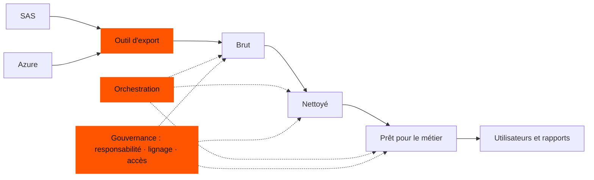

## Sur quoi je travaille

Depuis mai 2026, je suis en alternance dans un grand groupe d'assurance. Ma mission n'est pas un pipeline ou un datamart : ce sont les **fondations d'une plateforme de données sur Databricks**.

- **Une architecture en médaillon** **découplée de l'infrastructure**, pour que l'organisation des données ne dépende pas de l'endroit où elles tournent.
- **L'orchestration des pipelines** : planifier et exécuter les pipelines de données de façon fiable.
- **La gouvernance des données** : savoir quelles données existent, qui peut les utiliser et d'où elles viennent.
- **La migration de traitements de SAS vers PySpark**, avec les difficultés techniques qui l'accompagnent.
- **Un outil d'export** qui déplace des données de SAS et d'Azure *directement* vers Databricks.

<Callout tone="brand">L'outil d'export existe à cause de contraintes propres à l'entreprise. Il n'a de sens que dans ce contexte, ce qui explique aussi pourquoi je le décris ici à haut niveau plutôt qu'en détail.</Callout>

## L'idée du médaillon, en mots simples

Une architecture en médaillon organise les données en couches, chacune plus fiable que la précédente : les données **brutes**, exactement comme elles sont arrivées ; les données **nettoyées**, vérifiées et standardisées ; et les données **prêtes pour le métier**, façonnées pour ceux qui les utilisent. Garder les couches indépendantes de l'infrastructure permet à la même organisation de survivre à un changement d'outillage.

C'est un modèle, pas un dogme. Chaque équipe peut ajouter ou retirer des couches selon ses besoins : une équipe aux sources simples et propres n'a pas forcément besoin d'une couche nettoyée distincte, alors qu'une autre ajoutera une étape de plus pour un jeu de données sensible ou très partagé. Ce qui compte, c'est que chaque couche ait un rôle clair, pas leur nombre.

## Ce que je peux et ne peux pas montrer

Le code, les données et l'architecture interne appartiennent à l'entreprise : rien de tout cela n'apparaît sur ce site. Ce que je peux partager, c'est la forme du travail et le genre de problèmes qu'il soulève.

## Pourquoi ce type de travail est difficile

Voici les familles de problèmes qui accompagnent typiquement la construction d'une telle plateforme :

<Table
  data={{
    headers: [
      { content: "Domaine", key: "area" },
      { content: "Pourquoi il demande du soin", key: "why" }
    ],
    rows: [
      ["Découplage de l'infrastructure", "Il est tentant de laisser l'outillage de la plateforme déteindre sur l'organisation des données ; garder les deux séparés demande de la discipline et des frontières claires."],
      ["Une orchestration de confiance", "Les pipelines doivent s'exécuter dans le bon ordre, échouer de façon visible et pouvoir être relancés sans risque."],
      ["Gouvernance", "Une donnée n'est utile que si l'on peut la trouver, lui faire confiance et être autorisé à l'utiliser — ce qui demande responsabilité, lignage et règles d'accès."],
      ["Sémantiques différentes (SAS vers Spark)", "SAS et Spark ne traitent pas de la même façon les valeurs manquantes, les dates, le tri et le traitement ligne à ligne : une réécriture littérale peut changer des résultats en silence."],
      ["Prouver l'équivalence", "Les résultats migrés doivent correspondre aux originaux, ce qui demande une réconciliation systématique."],
      ["Faire passer les données", "Les données doivent quitter leurs systèmes sources de façon fiable et arriver dans la nouvelle plateforme, sous les contraintes de sécurité et de réseau de l'entreprise."]
    ]
  }}
/>

## Pourquoi c'est important pour moi

C'est la première fois que mon travail s'exécute dans une vraie organisation, avec de vraies contraintes : des systèmes hérités, des données dont des gens dépendent, et un changement de plateforme qui doit rester invisible pour ceux qui utilisent le résultat. C'est exactement le genre de data engineering que je veux faire après mon Master.

*Le détail des difficultés que j'ai réellement résolues relève d'une conversation, pas d'une page publique.*
