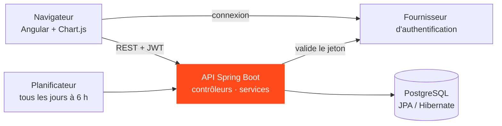

## Pourquoi ce projet

C'était mon initiation au développement web, réalisée pendant mon Master. C'était la première fois que j'assemblais une base de données, une API REST et une interface de navigateur en un produit fonctionnel, en devant les faire s'accorder.

## Ce que fait l'application

<Table
  data={{
    headers: [
      { content: "Domaine", key: "area" },
      { content: "Ce qu'on peut faire", key: "what" }
    ],
    rows: [
      ["Transactions et catégories", "Enregistrer les revenus et les dépenses et les ranger par catégories"],
      ["Budgets", "Fixer une limite par catégorie et être alerté quand elle approche"],
      ["Objectifs", "Suivre la progression vers un objectif d'épargne"],
      ["Dettes", "Garder la trace de ce qu'on doit et de ce qu'on nous doit"],
      ["Transactions planifiées", "Des paiements récurrents exécutés automatiquement chaque jour à 6 h"],
      ["Calendrier", "Voir les événements et paiements à venir"],
      ["Tableau de bord", "Un résumé, les dépenses par catégorie, la progression des objectifs et les alertes de budget"]
    ]
  }}
/>

## Comment c'est construit

<Table
  data={{
    headers: [
      { content: "Partie", key: "part" },
      { content: "Technologie", key: "tech" },
      { content: "Rôle", key: "role" }
    ],
    rows: [
      ["API", "Java 21, Spring Boot 3", "Points d'accès REST pour chaque domaine, organisés en contrôleurs, services, dépôts, DTO et mappers"],
      ["Sécurité", "Spring Security avec OAuth2", "Valide les jetons JSON Web Token émis par le fournisseur d'authentification, pour que chaque utilisateur ne voie que ses données"],
      ["Base de données", "PostgreSQL via JPA / Hibernate", "Stockage relationnel, avec un script relançable qui charge des données de démonstration"],
      ["Planification", "Spring Scheduler", "Exécute automatiquement les transactions planifiées"],
      ["Documentation", "Swagger / OpenAPI", "Documentation interactive de toute l'API"],
      ["Frontend", "Angular, Chart.js, client Supabase", "Des pages pour chaque fonctionnalité, des graphiques pour le tableau de bord, la connexion"]
    ]
  }}
/>

## Ce que j'ai appris

- Comment une **API en couches** garde les responsabilités séparées : les contrôleurs reçoivent, les services décident, les dépôts parlent à la base de données.
- Comment fonctionnent les **jetons d'authentification** de bout en bout, de la connexion dans le navigateur à la validation côté serveur.
- Comment gérer les erreurs à un seul endroit avec un gestionnaire d'exceptions global, pour que le frontend reçoive toujours un message clair.
- À quel point la forme du **modèle de données** conditionne tout le reste, dans l'API comme dans l'interface.

## État d'avancement

Terminé et rendu en mars 2026. C'était un projet d'apprentissage, pas un produit : sa valeur pour moi a été de voir une fois chaque couche d'une application web, avant de passer au data engineering.

<Button
  variant="primary"
  label="Voir le backend sur GitHub"
  href="https://github.com/aemane-m/Rendu_Finance_Tracker_BackEnd"
  target="_blank"
  rel="noopener"
/>
