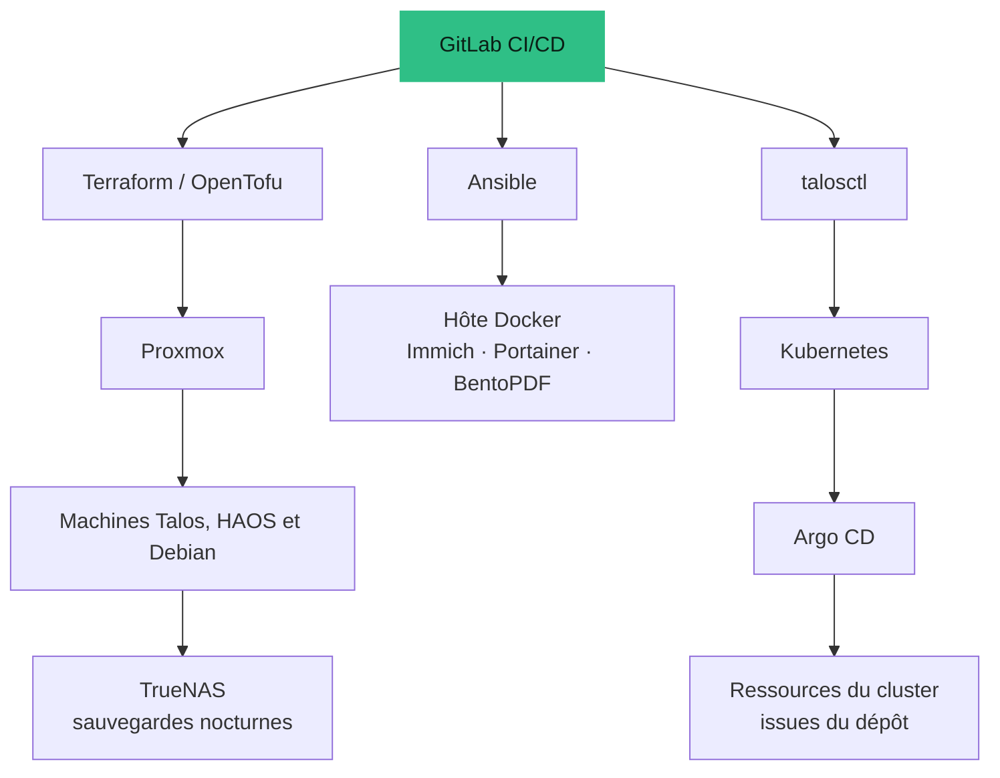

## Pourquoi je l'exploite

Je préfère garder mes données plutôt que les confier au cloud de quelqu'un d'autre. Mes photos de famille et de mes travaux argentiques vivent donc dans **Immich**, ma maison est pilotée par **Home Assistant**, et tout est sauvegardé sur une machine **TrueNAS** qui m'appartient. C'est tout l'enjeu du labo : la **souveraineté des données**.

C'est aussi là que j'apprends. Je me forme à **Terraform** en l'utilisant pour créer les machines virtuelles sur Proxmox, et le reste du labo (cluster, sauvegardes, services) suit la même habitude : décrit dans Git, relu, puis appliqué.

<Callout tone="brand">Le but n'est pas d'empiler des services. C'est une plateforme à laquelle je confie mes propres données, et un endroit pour pratiquer des réflexes de production sur quelque chose dont je dépends vraiment.</Callout>

## Apprendre, pas dogmatiser

Le but de ce labo est d'**apprendre et de me familiariser avec ces outils**. Je sais qu'aucun n'est l'alpha et l'oméga : Docker fait déjà beaucoup tout seul, et une machine virtuelle est souvent tout ce qu'un besoin demande. C'est pourquoi Immich et Portainer tournent sur un simple hôte Docker, et pourquoi le cluster Kubernetes est un endroit où pratiquer plutôt qu'une nécessité. Je ne gère pas d'infrastructure au travail (j'utilise Databricks), donc je veux comprendre Kubernetes par moi-même, puisqu'il fait partie de la stack data moderne : la compétence que je veux, c'est savoir quand cela en vaut la peine, et quand non.

## Ce qui tourne dessus

<Table
  data={{
    headers: [
      { content: "Service", key: "svc" },
      { content: "Pourquoi je l'héberge", key: "why" }
    ],
    rows: [
      ["Immich", "Bibliothèque de photos et vidéos qui reste sur mon propre stockage plutôt que chez un service tiers"],
      ["Home Assistant", "Domotique exécutée en local, dans sa propre machine virtuelle"],
      ["TrueNAS", "La cible de sauvegarde de toutes les machines virtuelles, plus Time Machine pour mes Mac"],
      ["Portainer, BentoPDF", "Gestion de conteneurs et un outil documentaire, sur un petit hôte Docker"],
      ["Kubernetes Talos", "Un cluster de trois nœuds pour expérimenter : outils data et MLOps, gérés en GitOps"]
    ]
  }}
/>

## Comment les pièces s'articulent

<Table
  data={{
    headers: [
      { content: "Couche", key: "layer" },
      { content: "Technologie", key: "tech" },
      { content: "Rôle", key: "role" }
    ],
    rows: [
      ["Réseau", "Passerelle UniFi", "Routage, DHCP, DNS et VLAN pour tout le labo"],
      ["Virtualisation", "Proxmox VE, trois nœuds", "Héberge les VM Talos (control-plane/worker), Home Assistant et une VM Docker"],
      ["Provisionnement", "Terraform / OpenTofu (bpg/proxmox, version épinglée)", "Crée et possède les machines virtuelles"],
      ["Kubernetes", "Talos Linux, Cilium", "Nœuds immuables pilotés par API ; Cilium pour le réseau et la Gateway"],
      ["GitOps", "Argo CD", "Réconcilie en continu le cluster depuis le dépôt"],
      ["Services de plateforme", "Longhorn, CloudNativePG, Vault, observabilité", "Stockage, bases de données, secrets et supervision"],
      ["Charges data", "Airflow, MLflow, Feast, FastAPI", "La même pile MLOps que mon projet Quant-MLOps, exécutée sur le cluster"],
      ["Configuration", "Ansible", "Configure l'hôte Docker et l'outillage de sauvegarde Proxmox"],
      ["CI/CD", "GitLab CI avec un runner local", "Valide chaque merge request et produit un plan ; l'application est une étape volontaire"],
      ["Accès distant", "Tailscale", "Accès privé aux applications du cluster via la Gateway Cilium"]
    ]
  }}
/>

## Des sauvegardes qui se gèrent toutes seules

Les sauvegardes sont lancées chaque nuit par un minuteur systemd sur un nœud Proxmox. Le script d'orchestration allume le NAS via son contrôleur de gestion, attend les partages de fichiers, sauvegarde les VM de chaque nœud, déclenche une sauvegarde Time Machine pour mon Mac, puis demande au NAS de s'éteindre proprement. En cas d'erreur Proxmox ou NAS, il s'arrête et **laisse le NAS allumé** plutôt que de couper l'alimentation en plein travail. Si la cible Mac est en veille, il réessaie pendant une minute, journalise un avertissement et continue.

<Callout tone="success">Un détail que j'aime : le cas d'échec est conçu en premier. Le script est construit pour qu'une erreur ne provoque jamais un arrêt dangereux.</Callout>

## Ce que ça coûte à faire tourner

Je mesure l'électricité que consomme le labo. Mesuré à la prise, le **homelab entier** consomme en moyenne environ **115 W** : à peu près **3 kWh par jour**, soit environ **90 kWh par mois**. C'est très stable d'un jour à l'autre.

## Des décisions qui méritent une explication

- **Version du provider épinglée.** Le provider Proxmox est épinglé sur une version exacte, parce qu'un code d'infrastructure qui change de comportement en silence est pire qu'un code un peu en retard.
- **Type de CPU `host` sur les VM Talos.** Talos exige un niveau x86-64 moderne, donc les VM utilisent le CPU de l'hôte. Contrepartie : pas de migration à chaud entre CPU différents, donc le placement des VM est fixe et documenté.
- **Disques locaux pour les VM, Longhorn seulement pour les volumes Kubernetes.** Pas de stockage Proxmox partagé ni de Ceph — une conception volontairement petite pour un petit cluster.
- **L'humain garde la main sur les étapes risquées.** L'amorçage de Talos et de GitOps sont des actions manuelles protégées ; tout le reste passe par des merge requests.

## La documentation comme livrable

Le dépôt contient un journal de déploiement qui consigne les choix, les incidents et la façon dont chacun a été résolu, un runbook pour reconstruire Kubernetes de Cilium à Vault, CloudNativePG et Airflow, et une note de reprise après sinistre. Écrire tout cela fait partie du travail, pas d'un à-côté.

## État d'avancement

En cours, et honnêtement **toujours un projet d'apprentissage** : je suis nouveau sur Terraform et je traite chaque erreur comme faisant partie de la formation. C'est un environnement personnel, pas un service de production — ce qui en fait justement un endroit sûr pour apprendre des réflexes de production.
