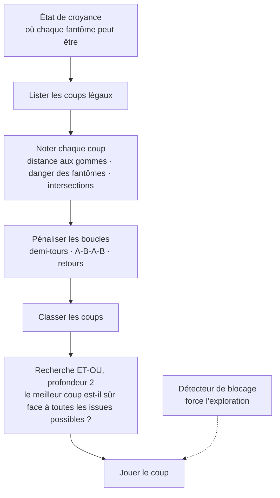

## Le problème

Dans cette version de Pacman, **les fantômes ne sont pas toujours visibles**. Pacman ne voit un fantôme que s'il est en ligne droite, sur la même ligne ou la même colonne. Le reste du temps, le jeu ne dit pas à l'agent où chaque fantôme *est*, mais l'**ensemble des endroits où il pourrait être**. Cet ensemble s'appelle un *état de croyance*.

L'agent ne peut donc pas simplement fuir ce qu'il voit. Il doit décider en tenant compte de ce qu'il *ne voit pas*, et le faire vite : le jeu continue d'avancer.

<Callout tone="brand">La question derrière le projet : comment bien agir quand l'information est incomplète et le temps de réflexion minuscule ?</Callout>

## Comment l'agent décide

Le moteur du jeu, le plateau et le modèle d'états de croyance étaient fournis avec le projet. La partie que j'ai écrite est la prise de décision : l'agent qui choisit le prochain coup de Pacman.

<Table
  data={{
    headers: [
      { content: "Élément", key: "part" },
      { content: "Ce qu'il fait", key: "does" }
    ],
    rows: [
      ["Distance aux gommes", "Un parcours en largeur trouve la gomme la plus proche, avec une limite sur la distance explorée, pour rester rapide sur un grand plateau"],
      ["Danger des fantômes", "Aller vers un fantôme visible est très fortement pénalisé ; un fantôme qui pourrait me voir compte comme plus dangereux"],
      ["Intersections", "Un petit bonus pour les carrefours, où il y a plus de place pour s'échapper"],
      ["Détection de boucles", "Des pénalités pour revenir sur une case, faire demi-tour, et répéter des motifs comme A-B-A-B ou A-B-C-A-B-C"],
      ["Détecteur de blocage", "Si Pacman reste trop longtemps sur la même case, il force un coup qui explore un endroit nouveau"],
      ["Recherche ET-OU", "Regarde deux coups à l'avance, en tenant compte de tous les coups que les fantômes pourraient jouer, pour vérifier qu'un coup est sûr. Elle a un budget de temps strict (50 microsecondes), donc dans la configuration finale seul le coup le mieux classé est vérifié"]
    ]
  }}
/>

Une bonne part du travail relève de l'ingénierie de performance. La recherche utilise des tampons réutilisables au lieu d'allouer de la mémoire à chaque étape, et chaque décision a un budget de temps, parce qu'une IA qui réfléchit parfaitement mais trop lentement perd quand même la partie.

## Comment j'ai mesuré

Le jeu peut tourner sans écran, dans un **mode batch** qui enchaîne des centaines de parties et enregistre le score et le temps mis à décider. Je m'en suis servi pour comparer les versions successives de l'agent (le projet en garde plusieurs, avec les journaux d'actions des exécutions batch).

<Table
  data={{
    headers: [
      { content: "Parties jouées", key: "n" },
      { content: "Score moyen", key: "mean" },
      { content: "Score médian", key: "median" },
      { content: "Meilleure partie", key: "best" }
    ],
    rows: [
      ["50", "2 883", "1 765", "7 350"],
      ["100", "3 746", "1 810", "22 250"],
      ["1 000", "3 159", "1 770", "36 860"]
    ]
  }}
/>

Sur l'exécution de 1 000 parties, l'agent met **environ 1,3 milliseconde par décision** en moyenne, et neuf parties sur dix totalisent moins d'environ 6 800 points.

### Lire les chiffres honnêtement

La **médiane est très inférieure à la moyenne** (environ 1 770 contre 3 160). Cela me dit que les scores sont très inégaux : beaucoup de parties s'arrêtent tôt, et quelques très bonnes tirent la moyenne vers le haut, jusqu'à 36 860. La moyenne seule flatterait l'agent. La médiane montre à quoi ressemble une partie typique.

## Limites, et ce que j'ai appris

- **Les poids sont réglés à la main.** L'heuristique repose sur de nombreuses constantes (ce que vaut une gomme, à quel point on craint un fantôme). Elles fonctionnent, mais ne sont pas optimisées de façon systématique.
- **L'incertitude est difficile à gérer avec prudence.** Un agent prudent survit plus longtemps mais mange moins de gommes ; un audacieux marque plus mais meurt plus tôt. Trouver l'équilibre a été l'essentiel du travail.
- **Mesurer, ne pas deviner.** Jouer mille parties m'a fait voir des choses que quelques parties cachent, comme cet écart entre moyenne et médiane.
- **Un budget de temps façonne la conception.** Devoir décider assez vite m'a poussé à simplifier : des recherches plafonnées, des tampons réutilisés, la vérification du seul meilleur coup.
