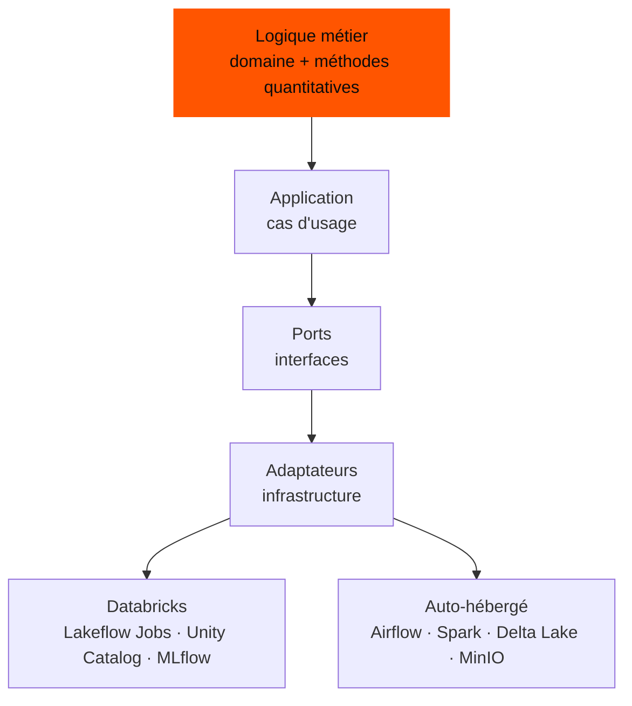
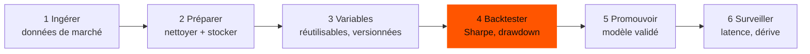

<Callout tone="neutral">QuantLab est la nouvelle version d'un projet que j'avais d'abord appelé **Quant-MLOps**. Il garde l'objectif de départ et reconstruit la plateforme autour d'un second : la portabilité.</Callout>

## Deux problèmes, un seul projet

**Une recherche impossible à reproduire.** En finance quantitative, la recherche vit souvent dans des scripts isolés : on lance un backtest, on note un chiffre, et un mois plus tard personne ne sait dire quelles données et quels paramètres l'ont produit. Les modèles qui brillent en recherche arrivent rarement en production, et une fois en place, peu d'outils permettent de voir s'ils dérivent.

**Des plateformes qui enferment.** Une plateforme de données grandit souvent autour de l'outil sur lequel elle a été construite. Si l'on change, la logique métier, qui est la partie importante, doit être réécrite.

QuantLab répond aux deux. Chaque exécution est tracée, donc les résultats sont **comparables et fiables**, et la logique ne sait jamais sur quelle plateforme elle tourne.

<Callout tone="brand">Le même code tourne sur Databricks et sur une pile auto-hébergée. Seule une fine couche d'adaptateurs change.</Callout>

## Comment c'est construit

Le projet suit une architecture hexagonale, qui garde tout ce qui dépend d'une plateforme en périphérie :

<Table
  data={{
    headers: [
      { content: "Besoin", key: "concern" },
      { content: "Sur Databricks", key: "dbx" },
      { content: "Auto-hébergé", key: "self" }
    ],
    rows: [
      ["Orchestration", "Lakeflow Jobs", "Airflow"],
      ["Calcul", "Spark sur Databricks", "Apache Spark"],
      ["Tables", "Unity Catalog", "Delta Lake"],
      ["Suivi des expériences", "MLflow managé", "MLflow"],
      ["Stockage objet", "Stockage cloud", "MinIO"]
    ]
  }}
/>

## Le parcours de la recherche

De la donnée de marché brute au modèle surveillé, en six étapes :

<Table
  data={{
    headers: [
      { content: "Étape", key: "step" },
      { content: "Ce qui se passe", key: "what" },
      { content: "Outils", key: "tool" }
    ],
    rows: [
      ["Ingérer", "Collecter les données de marché et déclencher les pipelines à heure fixe", "Airflow (ou Lakeflow Jobs)"],
      ["Préparer", "Nettoyer les données et les stocker en séries temporelles, dans des formats ouverts", "Parquet, Delta Lake, TimescaleDB"],
      ["Variables", "Calculer les variables une fois, et les réutiliser pour l'entraînement comme pour le service", "Feast"],
      ["Backtester", "Lancer des stratégies Markowitz, Black-Litterman et Risk Parity ; enregistrer le ratio de Sharpe, le drawdown maximal et le turnover", "scikit-learn, PyPortfolioOpt, statsmodels, MLflow"],
      ["Promouvoir", "Faire passer un modèle validé de la préproduction à la production et l'exposer", "Registre MLflow, FastAPI"],
      ["Surveiller", "Suivre la latence, la dérive des données et la performance en conditions réelles", "Prometheus, Grafana"]
    ]
  }}
/>

## Les règles qui gardent le code portable

- Aucun import spécifique à Databricks dans le code du domaine, de l'application, des méthodes quantitatives ou de Spark.
- Aucun import d'Airflow en dehors du dossier d'orchestration Airflow.
- Chaque dépendance à l'infrastructure vit dans un adaptateur dédié.
- Les transformations Spark restent portables, et le dépôt prévoit un espace pour des tests de compatibilité entre environnements d'exécution.

## Pourquoi je l'ai construit

Je travaille avec Databricks, et je fais aussi tourner un homelab Kubernetes avec Airflow, MLflow et du stockage objet. QuantLab est le point de rencontre de ces deux mondes. C'est un moyen de pratiquer le MLOps de bout en bout sur un sujet réaliste, d'apprendre ce qui dépend vraiment d'une plateforme et ce qui n'en dépend pas, et d'éviter que mon travail soit lié à un seul fournisseur.

## Où il en est

Il est encore au début. L'architecture et les règles de portabilité sont posées. Les pipelines d'ingestion sont en cours de conception et le schéma de stockage est en cours de définition ; le suivi des expériences, le magasin de variables, l'API et les tableaux de bord restent à brancher. Il ne revendique pas encore de résultats en production.

<Table
  data={{
    headers: [
      { content: "Prochaine étape", key: "next" },
      { content: "Prévu", key: "plan" }
    ],
    rows: [
      ["Pipelines", "Stabiliser l'ingestion quotidienne, puis calculer les premières variables et lancer les premiers backtests"],
      ["Suivi et service", "Brancher MLflow pour la promotion des modèles, puis exposer l'API et la surveillance"],
      ["Déploiement", "Le faire tourner sur le homelab Kubernetes (Helm, secrets, contrôle d'accès)"],
      ["Documentation", "Un guide complet et des cas d'usage reproductibles"]
    ]
  }}
/>
