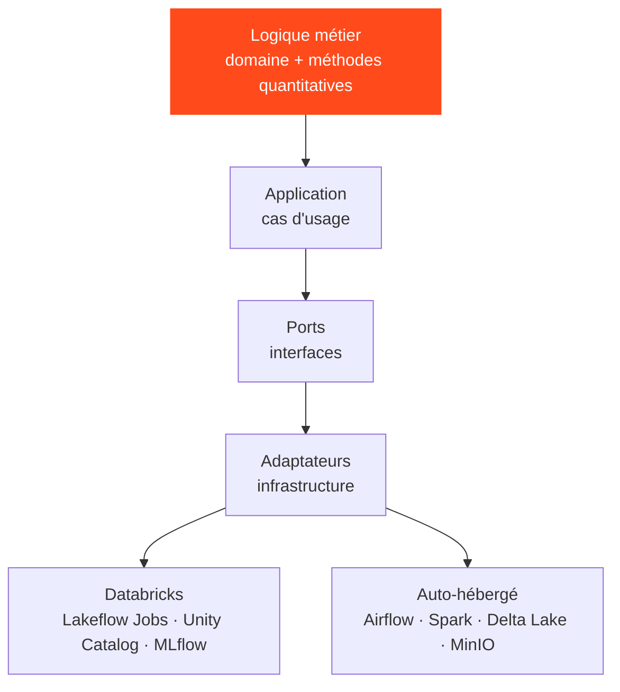

## Le problème traité

Les plateformes de données ont tendance à grandir autour de l'outil sur lequel elles ont été construites. Changez de plateforme et la logique métier — la partie qui compte vraiment — doit être réécrite. QuantLab pose une autre question : **et si la logique ne savait jamais sur quelle plateforme elle tourne ?**

<Callout tone="brand">Le même code tourne sur Databricks et sur une pile auto-hébergée. Seule une fine couche d'adaptateurs change.</Callout>

## Comment c'est construit

Le projet utilise une architecture hexagonale, qui garde les parties propres à une plateforme à la périphérie :

<Table
  data={{
    headers: [
      { content: "Besoin", key: "concern" },
      { content: "Sur Databricks", key: "dbx" },
      { content: "Auto-hébergé", key: "self" }
    ],
    rows: [
      ["Orchestration", "Lakeflow Jobs", "Airflow"],
      ["Calcul", "Spark sur Databricks", "Apache Spark"],
      ["Tables", "Unity Catalog", "Delta Lake"],
      ["Suivi d'expériences", "MLflow managé", "MLflow"],
      ["Stockage objet", "Stockage cloud", "MinIO"]
    ]
  }}
/>

## Les règles qui gardent la portabilité

- Aucun import spécifique à Databricks dans le code de domaine, d'application, quantitatif ou Spark.
- Aucun import Airflow en dehors du dossier d'orchestration Airflow.
- Tout couplage avec l'infrastructure vit dans un adaptateur dédié.
- Les transformations Spark restent portables, et le dépôt prévoit un emplacement pour des tests de compatibilité entre environnements.

## Pourquoi je l'ai construit

Je travaille avec Databricks, et je fais aussi tourner un homelab Kubernetes avec Airflow, MLflow et du stockage objet. QuantLab est l'endroit où ces deux mondes se rencontrent : c'est une façon d'apprendre ce qui est réellement propre à une plateforme et ce qui ne l'est pas, et de ne pas lier mon propre travail à un seul fournisseur.

## État d'avancement

Début de projet, en cours : le dépôt a été créé en septembre 2026. Il pose l'architecture et les règles de portabilité ; il ne prétend pas encore à des résultats en production.
