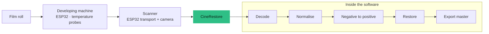

## How I got into film

It started when a friend told me about buying her first analogue camera. That is how I discovered the subject, and I fell down the rabbit hole: I began collecting cameras and reading everything I could on it.

When I then discovered Super 8 films, I realised they are becoming rarer and rarer. That gave me the idea of scanning them too, and of working on the restoration of abandoned films, whether 8 mm, 16 mm or 35 mm.

## Why build the machines

Fully automatic film machines are expensive. Building my own is a challenge: do better, and for less. I can also write software, so this project is a fusion of everything I do. I follow what is happening in open source closely, and it saves me a lot of time.

I am also making CineRestore for the members of my photo association and for beginners in analogue photography: an all-in-one program that helps them get started and follow the whole life cycle of a roll of film. Photo film and motion-picture film (Super 8 and similar formats) overlap, and the software comes first because I need it to control the machines I will build afterwards.

## Why this project exists

I shoot and develop analogue film. Every step — developing, scanning, cleaning up dust and scratches — usually lives in a different tool, with no record of what was done to an image. CineRestore puts the whole path in one place and keeps it **traceable**: each frame knows which roll it came from, how it was captured and what was changed.

It deliberately stops where creative work begins. It prepares a neutral master and leaves editing and colour grading to the tools made for that.

<Callout tone="brand">Three responsibilities, nothing more: acquire every frame without loss, correct the technical defects of the scan and the film, and deliver a master whose colour, frame rate and provenance are explicitly described.</Callout>

## Three machines, one program — all in development

<Table
  data={{
    headers: [
      { content: "Machine", key: "machine" },
      { content: "What it does", key: "does" },
      { content: "How it is designed", key: "how" },
      { content: "Where it stands", key: "stand" }
    ],
    rows: [
      ["120/135 photo scanner", "Advances a strip of film frame by frame while a camera captures each view", "Single-motor transport driven by an ESP32; serial protocol with acknowledgements; the camera is triggered and the file is awaited until stable", "Firmware and control code written; not yet validated on the real machine"],
      ["Film-developing machine (\"Lab\")", "Runs a developing recipe: pre-wash, developer, stop, fixer, wash — with timing, agitation and temperature", "ESP32 firmware, PT100 temperature probe through a MAX31865 amplifier, stepper driver, a watchdog, and recipes sent with acknowledged commands", "Firmware and wiring plan written; wiring and thermal tests still to do"],
      ["8/16/35 mm cine scanner", "Scans motion-picture film one frame at a time", "Mechanics modelled on the open-source Gugusse scanner, a separate transport with its own protocol, RAW capture from a Raspberry Pi camera", "At the design stage: control software and a proposed electronics design exist; the physical bench is still to be built"]
    ]
  }}
/>

The cine scanner starts from the mechanical model of [Gugusse](https://www.deniscarl.com/dokuwiki/doku.php), an open-source film scanner by Denis Carl. The control module in CineRestore is my own implementation; the mechanics are his reference.

## The software

<Table
  data={{
    headers: [
      { content: "Part", key: "part" },
      { content: "Technology", key: "tech" },
      { content: "Role", key: "role" }
    ],
    rows: [
      ["Engine", "Rust workspace (imaging, scan, lab, film, export, persistence)", "Decoding, negative-to-positive conversion, restoration, colour management and export"],
      ["Application", "Tauri 2 + React/TypeScript, with a Storybook design system", "Four stages in one window: recipe, development, scanning, restoration"],
      ["Firmware", "ESP32 sketches for the scanner transport and the developing machine", "Real-time control of motors, heaters and sensors"],
      ["Colour", "RAW decoding, ICC profiles, ArgyllCMS characterisation procedures", "Neutral, measurable colour from a camera sensor"],
      ["Video export", "FFmpeg built from a pinned source and embedded in the app", "ProRes/H.264 output for film sequences, with checks for missing or duplicate frames"],
      ["Delivery", "CI producing a signed macOS disk image", "Rust, interface, architecture-freeze and licence checks on every change"]
    ]
  }}
/>

<Media
  src="/images/projects/cinerestore/dev-darkroom.jpg"
  alt="Interface design: the developing stage, with step timer, temperature probes and protocol"
  aspectRatio="16/10"
/>

<Media
  src="/images/projects/cinerestore/scan.jpg"
  alt="Interface design: the scanning stage, preparing a capture session for a 36-frame roll"
  aspectRatio="16/10"
/>

*Images are interface design mock-ups the app is built to match (shown with sample data); the cover above is the restoration stage.*

## Engineering choices

- **Data first.** Every roll, frame, recipe and session is persisted and can be resumed after an interruption; missing and duplicate frames are detected.
- **One authority per concern.** An architecture-freeze check in CI refuses a second competing RAW, ICC or colour engine unless a real case justifies it.
- **Typed pipeline.** Decoding, technical normalisation, negative conversion, restoration and export are separate, typed stages with one image-input contract.
- **Safety in hardware paths.** The developing machine has a watchdog, and state-changing commands wait for an acknowledgement before the interface believes them.

## What I would like you to take away

I am open to exploring many subjects that have nothing to do with each other. At first glance, data engineering and analogue film share very little. But what I know about software development lets me explore both.

## Where it honestly stands

The repository keeps a validation report that separates what is *coded and tested in software* from what still needs *real hardware*. As of its 1 November 2026 version:

- **Software checks pass.** The Rust test suite passes (818 tests, with 29 deliberately skipped because they need private RAW files or a real reel), and the interface builds.
- **Image decoding is verified on three kinds of source** — a Bayer DNG from a Ricoh GR III, a Fujifilm X-Trans RAF and a Cintel CRI file — each against a pinned checksum. That validates the decoders on representative files, not a full physical reel.
- **Multi-channel alignment is tested** on synthetic images (red, green, blue and infrared), and the quality check now detects clipping that affects a single colour channel.

What is still blocked by hardware: a complete real reel, the photo scanner (it was not connected to the software at the time of the check), infrared lighting, and colour calibration with a transparent test target. The colour reference files for the Cintel workflow are kept as diagnostic material, not declared validated. And one limit to be clear about: today the software assembles several channels of **one** frame; it does not stitch overlapping shots, which would be a separate module.

<Callout tone="neutral">I keep that distinction on the page on purpose: "it compiles and the tests pass" and "it works on a real roll" are different claims, and I would rather be clear about which one I am making.</Callout>
