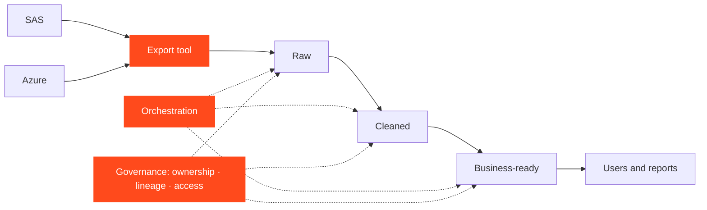

## What I'm working on

Since May 2026 I have been in work-study at a financial-services group. My assignment is not one pipeline or one datamart: it is the **foundations of a data platform on Databricks**.

- **A medallion architecture** that is **decoupled from the infrastructure**, so the way data is organised does not depend on where it happens to run.
- **Pipeline orchestration**: scheduling and running data pipelines reliably.
- **Data governance**: knowing what data exists, who can use it and where it comes from.
- **Moving workloads from SAS to PySpark**, with the technical challenges that come with it.
- **An export tool** that moves data from SAS and Azure *directly* into Databricks.

<Callout tone="brand">The export tool exists because of constraints specific to the company. It only makes sense in that context, which is also why I describe it here at a high level rather than in detail.</Callout>

## The medallion idea, in plain words

A medallion architecture organises data in layers, each one more trustworthy than the last: **raw** data exactly as it arrived, **cleaned** data that has been checked and standardised, and **business-ready** data shaped for the people who use it. Keeping the layers independent of the infrastructure means the same organisation can survive a change of tooling.

## What I can and can't show

The code, the data and the internal architecture belong to the company, so none of them appear on this site. What I can share is the shape of the work and the kind of problems it raises.

## Why this kind of work is hard

These are the families of problem that typically come with building a platform like this:

<Table
  data={{
    headers: [
      { content: "Area", key: "area" },
      { content: "Why it needs care", key: "why" }
    ],
    rows: [
      ["Decoupling from the infrastructure", "It is tempting to let the platform's tooling leak into the data layout; keeping the two separate takes discipline and clear boundaries."],
      ["Orchestration you can trust", "Pipelines must run in the right order, fail visibly and be safe to re-run."],
      ["Governance", "Data is only useful if people can find it, trust it and are allowed to use it — which needs ownership, lineage and access rules."],
      ["Different semantics (SAS to Spark)", "SAS and Spark do not treat missing values, dates, sorting and row-by-row processing in the same way, so a literal rewrite can silently change results."],
      ["Proving equivalence", "Migrated results have to match the originals, which means systematic reconciliation."],
      ["Getting data across", "Data has to leave its source systems reliably and land in the new platform under the company's security and network constraints."]
    ]
  }}
/>

## Why it matters to me

This is the first time my work runs inside a real organisation with real constraints: legacy systems, data that people depend on, and a platform change that has to be invisible to the people who use the result. It is exactly the kind of data engineering I want to do after my Master's.

*Details of the challenges I actually solved belong in a conversation, not on a public page.*
