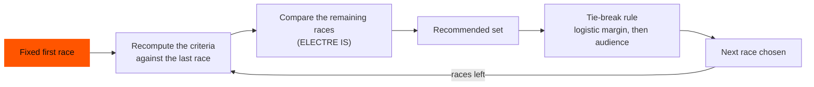

## The question

Building a Formula 1 calendar is a decision where everyone wants something different. The governing body cares about safety and feasibility, the commercial rights holder about revenue and audience, the teams about travel and fatigue, the local promoters about attendance and weather. Their goals pull in opposite directions, and you cannot add them up into one score.

So the question we asked was: **how do you build a calendar, one race at a time, so that each choice is a reasoned compromise, and not the output of a black box?**

<Callout tone="brand">The method does not say "this is the best calendar". It makes the trade-offs visible, which is what a decision-maker actually needs.</Callout>

## The method, in plain words

We used **ELECTRE IS**, a multi-criteria method built around *outranking*: option A outranks option B if it is at least as good on enough of the criteria, **and** it is not seriously worse on any of them. That last part matters. A race that is excellent commercially but very bad logistically cannot simply "buy back" its weakness: a strong enough drawback acts as a **veto**.

The decision is built **incrementally**. Starting from a fixed first race, at each step we compare all the remaining races against the last one chosen, and pick the next.

## What we compared

There are **24 Grands Prix** to place, judged on **8 criteria** grouped into three areas:

<Table
  data={{
    headers: [
      { content: "Area", key: "area" },
      { content: "Criteria", key: "criteria" },
      { content: "Goal", key: "goal" }
    ],
    rows: [
      ["Logistics & environment", "Distance from the previous race, estimated CO₂, change of region, available time margin", "Keep travel, emissions and disruption low"],
      ["Economy & audience", "Hosting fee, audience", "Maximise revenue and visibility"],
      ["Sporting & climate", "Weather score, delay between races", "Safe, good-quality racing with enough rest"]
    ]
  }}
/>

Some criteria belong to a race on its own (hosting fee, audience, weather). Others depend on **which race came just before**, such as distance and delay. Those are recomputed at every step.

## From raw data to criteria

The dataset is open. For each race it holds the circuit, country and region, date, coordinates, an estimated hosting fee and audience, and the monthly average temperature and rainfall.

Building the criteria meant making modelling choices, each one written down:

- **Distance** is the great-circle distance between circuits (the Haversine formula), because the question is global and macro-level, not a road itinerary.
- **CO₂** is a *proxy*: proportional to distance, because homogeneous emission data does not exist for calendar transitions.
- **Weather** is a composite score of temperature and rainfall for the month of the race.
- Hosting fees and audiences are **public estimates**, used as comparable proxies and flagged as such.

We kept a clear line between what is **observed**, what is **derived** by a fixed calculation, and what is **modelled** because the exact figure is not available. That line is what makes the model traceable and defensible.

## What it produces

At each step the method returns a **recommended set** of races that nothing else outranks, with explicit indicators, instead of one winner. When several races are recommended, that is a genuine result: it means the criteria truly conflict, and no race dominates.

To still reach an operational decision, we added an explicit **tie-break rule**: first the logistic margin, then the audience. The reasoning stays transparent because the rule is stated, not hidden in the code.

## What I learnt, and where it is limited

The report is candid about the limits, and I want to keep that here:

- The criteria are **proxies**: good enough to compare, but only a partial picture of the real constraints.
- The **weights and thresholds** are reasonable but subjective. With real experts they would be debated and adjusted.
- Because the construction is incremental and has no explicit time constraint, the method can favour races far apart in time, producing a path that is not strictly chronological.
- Major real-world constraints — contracts with circuits, politics, broadcasting — are **not in the model**.

For next steps we proposed a **temporal eligibility rule** (only races after the current one), and a **sensitivity analysis** on weights and thresholds to see which criteria really drive the result.

The main lesson for me: a method like this is valuable less for the answer than for how it structures the discussion and shows the cost of each choice. It is a tool to support a decision, not to make it automatically.

## Resources

The dataset and the Python implementation are public, and the full report (in French) is available to read.

<Button
  variant="primary"
  label="Read the report (PDF, in French)"
  href="/docs/f1-electre-decision-report.pdf"
  target="_blank"
  rel="noopener"
/>
