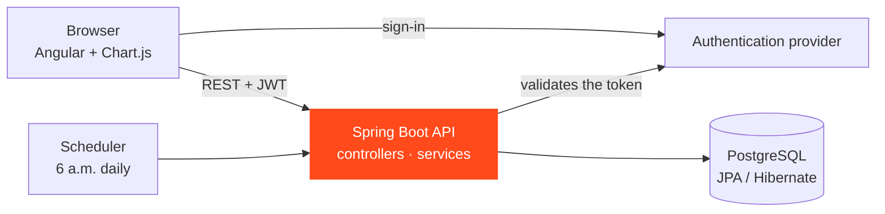

## Why this project

This was my introduction to web development, built during my MSc. It was the first time I put a database, a REST API and a browser interface together as one working product, and had to make them agree with each other.

## What the app does

<Table
  data={{
    headers: [
      { content: "Area", key: "area" },
      { content: "What you can do", key: "what" }
    ],
    rows: [
      ["Transactions and categories", "Record income and spending and sort it into categories"],
      ["Budgets", "Set a limit per category and get alerts as it is approached"],
      ["Goals", "Track progress towards a savings target"],
      ["Debts", "Keep track of what you owe and what is owed to you"],
      ["Planned transactions", "Recurring payments that are executed automatically every day at 6 a.m."],
      ["Calendar", "See upcoming events and payments"],
      ["Dashboard", "A summary, spending by category, goals progress and budget alerts"]
    ]
  }}
/>

## How it is built

<Table
  data={{
    headers: [
      { content: "Part", key: "part" },
      { content: "Technology", key: "tech" },
      { content: "Role", key: "role" }
    ],
    rows: [
      ["API", "Java 21, Spring Boot 3", "REST endpoints for every domain, organised as controllers, services, repositories, DTOs and mappers"],
      ["Security", "Spring Security with OAuth2", "Validates the JSON Web Tokens issued by the authentication provider, so each user only sees their own data"],
      ["Database", "PostgreSQL through JPA / Hibernate", "Relational storage, with a re-runnable script that loads demo data"],
      ["Scheduling", "Spring Scheduler", "Runs planned transactions automatically"],
      ["Documentation", "Swagger / OpenAPI", "Interactive documentation of the whole API"],
      ["Front end", "Angular, Chart.js, Supabase client", "Pages for each feature, charts for the dashboard, sign-in"]
    ]
  }}
/>

## What I learnt

- How a **layered API** keeps responsibilities apart: controllers receive, services decide, repositories talk to the database.
- How **authentication tokens** work end to end, from sign-in in the browser to validation on the server.
- How to handle errors in one place with a global exception handler, so the front end always gets a clear message.
- How much the shape of the **data model** drives everything else, in the API and in the interface.

## Status

Completed and delivered in March 2026. It was a learning project, not a product: its value to me was seeing every layer of a web application once, before moving on to data engineering.

<Button
  variant="primary"
  label="View the back end on GitHub"
  href="https://github.com/aemane-m/Rendu_Finance_Tracker_BackEnd"
  target="_blank"
  rel="noopener"
/>
