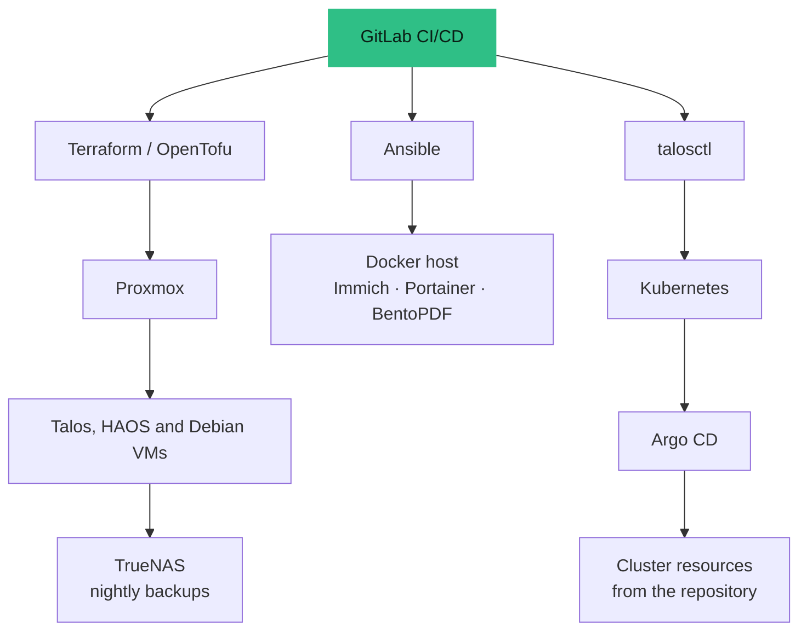

## How it started

I came to homelabbing through English-language content about networking: more and more people are interested in hosting their own data and learning to master the pieces behind it, and I got hooked by watching them do it.

Two things made me start. The first is the idea of **owning my data**. The second is that many technologies used in large companies are ones I would never get to touch unless I worked there. A homelab is a sandbox where I can learn them, test them and break them on my own time. Once you start, you want to go further, which is how I ended up with a whole network side built on UniFi.

What I enjoy most is discovering a new tool and understanding how it works behind the scenes: how it was designed, why it exists, and which problem it was built to solve. If I started again from zero, I would probably do the same thing.

## Why I run it

I would rather keep my own data than hand it to someone else's cloud. So the photos of my family and of my film work live in **Immich**, my house is run by **Home Assistant**, and everything is backed up to a **TrueNAS** machine I own. That is the point of the whole lab: **data sovereignty**.

It is also where I learn. I am teaching myself **Terraform** by using it to create the virtual machines on Proxmox, and the rest of the lab (cluster, backups, services) follows the same habit: described in Git, reviewed, then applied.

<Callout tone="brand">The goal is not a pile of services. It is a platform I trust with my own data, and a place to practise production habits on something I actually depend on.</Callout>

## Learning, not dogma

The point of this lab is to **learn and get familiar with these tools**. I know none of them is the alpha and omega: Docker handles a lot on its own, and a virtual machine is often all a need requires. That is why Immich and Portainer run on a plain Docker host, and why the Kubernetes cluster is a place to practise rather than a requirement. I want to understand Kubernetes first-hand, since it is part of the modern data stack: the skill I am after is knowing when it is worth it, and when it is not.

## What runs on it

<Table
  data={{
    headers: [
      { content: "Service", key: "svc" },
      { content: "Why I self-host it", key: "why" }
    ],
    rows: [
      ["Immich", "Photo and video library that stays on my own storage instead of a third-party service"],
      ["Home Assistant", "Home automation running locally, in its own virtual machine"],
      ["TrueNAS", "The backup target for every virtual machine, plus Time Machine for my Mac"],
      ["Portainer, BentoPDF", "Container management and a document tool, on a small Docker host"],
      ["Talos Kubernetes", "A three-node cluster for experiments: data and MLOps tools, managed through GitOps"]
    ]
  }}
/>

## The hardware

The three Proxmox nodes are **HP ProDesk Gen 5 mini PCs, bought second-hand**. They are small, quiet and draw little power.

<Table
  data={{
    headers: [
      { content: "Node", key: "node" },
      { content: "Memory", key: "ram" },
      { content: "Storage", key: "disk" }
    ],
    rows: [
      ["Node 1", "32 GB", "1 TB SSD"],
      ["Node 2", "16 GB", "256 GB SSD"],
      ["Node 3", "16 GB", "256 GB SSD"]
    ]
  }}
/>

## How the pieces fit together

<Table
  data={{
    headers: [
      { content: "Layer", key: "layer" },
      { content: "Technology", key: "tech" },
      { content: "What it does", key: "role" }
    ],
    rows: [
      ["Network", "UniFi gateway", "Routing, DHCP, DNS and VLANs for the whole lab"],
      ["Virtualisation", "Proxmox VE, three nodes", "Hosts the Talos control-plane/worker VMs, Home Assistant and a Docker VM"],
      ["Provisioning", "Terraform / OpenTofu (bpg/proxmox, version pinned)", "Creates and owns the virtual machines"],
      ["Kubernetes", "Talos Linux, Cilium", "Immutable, API-managed nodes; Cilium for networking and the Gateway"],
      ["GitOps", "Argo CD", "Continuously reconciles the cluster from the repository"],
      ["Platform services", "Longhorn, CloudNativePG, Vault, observability", "Storage, databases, secrets and monitoring"],
      ["Data workloads", "Airflow, MLflow, Feast, FastAPI", "The same MLOps stack as my QuantLab project, running on the cluster"],
      ["Configuration", "Ansible", "Configures the Docker host and the Proxmox backup tooling"],
      ["CI/CD", "GitLab CI with a local runner", "Validates every merge request and produces a plan; apply is a deliberate step"],
      ["Remote access", "Tailscale", "Private access to cluster applications through the Cilium Gateway"]
    ]
  }}
/>

## Backups that look after themselves

Backups run from a systemd timer on a Proxmox node every night. The orchestration script powers on the NAS through its management controller, waits for the file shares, backs up every node's VMs, triggers a Time Machine backup, and then asks the NAS to shut down cleanly. If a Proxmox or NAS error occurs it stops and **leaves the NAS on** rather than cutting power in the middle of something. If the Mac target is asleep it retries for a minute, logs a warning and carries on.

<Callout tone="success">A small detail I like: the failure mode is designed first. The script is built so that an error never causes an unsafe shutdown.</Callout>

## What it costs to run

I measure the electricity the lab uses. Measured at the plug, the **whole homelab** draws about **115 W** on average: roughly **3 kWh a day**, or about **90 kWh a month**. It is very steady from one day to the next.

If I started again, I would buy fewer machines and think harder about what each one is for. Electricity use is a real cost and it deserves to be part of the design. The second-hand HP ProDesk mini PCs I chose already help, since they draw far less than a classic server, but a leaner setup would be better still.

## Decisions worth explaining

- **Pinned provider version.** The Proxmox provider is pinned to an exact release, because infrastructure code that silently changes behaviour is worse than code that is a little out of date.
- **CPU type `host` on the Talos VMs.** Talos needs a modern x86-64 level, so the VMs use the host CPU. The trade-off is that live migration between different CPUs is off the table, so VM placement is fixed and documented.
- **Local disks for VMs, Longhorn only for Kubernetes volumes.** No shared Proxmox storage and no Ceph — a deliberately small design for a small cluster.
- **Humans stay in the loop for risky steps.** Bootstrapping Talos and GitOps are protected manual actions; everything else flows through merge requests.

## Documentation as a deliverable

The repository carries a deployment journal that records the choices, the incidents and how each one was solved, plus a runbook to rebuild Kubernetes from Cilium to Vault, CloudNativePG and Airflow, and a disaster-recovery note. Writing these down is part of the work, not an afterthought.

## What it taught me

The homelab taught me to be curious enough to take on a technology I do not know yet. That habit has helped me a lot in my work-study year.

Knowing other tools also lets me draw links with what I use at work, for example Databricks: I understand better how it is built and where each piece comes from. This year I also have a **big data course** covering **MapReduce**, which helps me understand what sits around Spark, and how it connects to Databricks.

I also stay curious about what is possible today. AI tools help me a lot as a junior: they let me understand concepts and break them down into simpler pieces.

## What I am proud of

I am proud of everything I have managed to build with so few resources: second-hand machines, a small budget, and a lot of time spent learning.

## Status

Ongoing, and honestly **still a learning project**: I am new to Terraform and I treat every mistake as part of the course. It is a personal environment, not a production service — which is exactly why it is a safe place to learn production habits.
