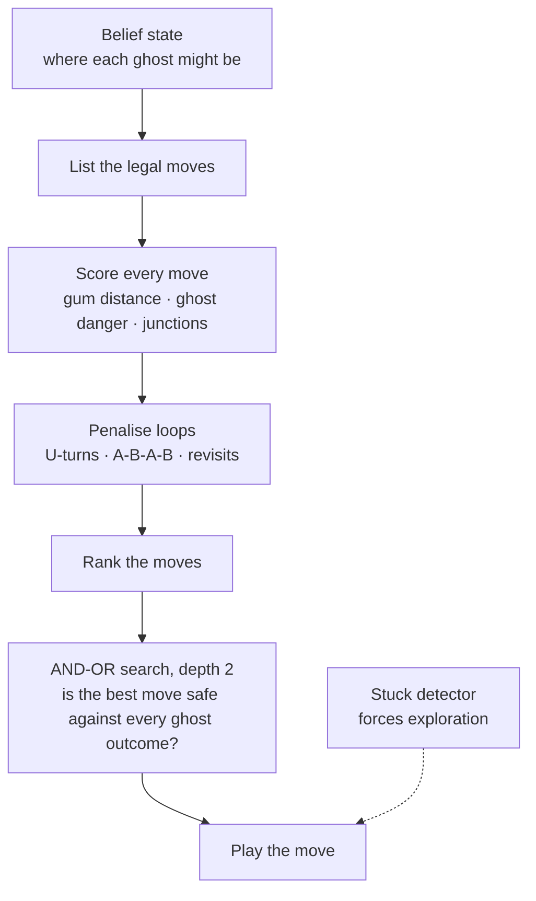

## The problem

In this version of Pacman, **the ghosts are not always visible**. Pacman only sees a ghost when it is in a straight line of sight along a row or a column. The rest of the time, the game tells the agent not where each ghost *is*, but the **set of places it could be**. That set is called a *belief state*.

So the agent cannot simply run away from what it sees. It has to decide while taking into account what it *cannot* see, and it must do so fast: the game keeps moving.

<Callout tone="brand">The question behind the project: how do you act well when your information is incomplete, and your time to think is tiny?</Callout>

## How the agent decides

The game engine, the board and the belief-state model came with the project. The part I wrote is the decision-making: the agent that picks Pacman's next move.

<Table
  data={{
    headers: [
      { content: "Part", key: "part" },
      { content: "What it does", key: "does" }
    ],
    rows: [
      ["Distance to the gums", "A breadth-first search finds the nearest gum, with a cap on how far it looks, so that it stays fast on a big board"],
      ["Ghost danger", "Moving toward a ghost I can see is penalised very heavily; a ghost that could see me counts as more dangerous"],
      ["Junctions", "A small bonus for intersections, where there is more room to escape"],
      ["Loop detection", "Penalties for revisiting a square, for U-turns, and for repeating patterns such as A-B-A-B or A-B-C-A-B-C"],
      ["Stuck detector", "If Pacman stays on the same square too long, it forces a move that explores somewhere new"],
      ["AND-OR search", "Looks two moves ahead, taking into account every move the ghosts could make, to check that a move is safe. It has a strict time budget (50 microseconds), so in the final configuration only the best-ranked move is checked"]
    ]
  }}
/>

A good share of the work is performance engineering. The search uses reusable buffers instead of allocating memory at every step, and every decision has a time budget, because an AI that thinks perfectly but too slowly loses the game anyway.

## How I measured it

The game can run without a screen, in a **batch mode** that plays hundreds of games in a row and records the score and the time taken to decide. I used it to compare successive versions of the agent (the project keeps several of them, along with the action logs of the batch runs).

<Table
  data={{
    headers: [
      { content: "Games played", key: "n" },
      { content: "Average score", key: "mean" },
      { content: "Median score", key: "median" },
      { content: "Best game", key: "best" }
    ],
    rows: [
      ["50", "2,883", "1,765", "7,350"],
      ["100", "3,746", "1,810", "22,250"],
      ["1,000", "3,159", "1,770", "36,860"]
    ]
  }}
/>

On the 1,000-game run, the agent takes **about 1.3 milliseconds per decision** on average, and nine games out of ten score below about 6,800 points.

### Reading the numbers honestly

The **median is far below the average** (about 1,770 against 3,160). That tells me the scores are very uneven: many games end early, and a few very good ones pull the average up, up to 36,860. The average alone would flatter the agent. The median is what a typical game looks like.

## Limits, and what I learnt

- **The weights are tuned by hand.** The heuristic relies on many constants (how much a gum is worth, how much a ghost is feared). They work, but they are not optimised in a systematic way.
- **Uncertainty is hard to be careful with.** A cautious agent survives longer but eats fewer gums; a bold one scores more but dies sooner. Finding the balance was most of the work.
- **Measure, don't guess.** Running a thousand games made me see things a handful of games hides, such as that spread between average and median.
- **A time budget shapes the design.** Deciding quickly enough pushed me to simplify: capped searches, reused buffers, checking only the best move.
