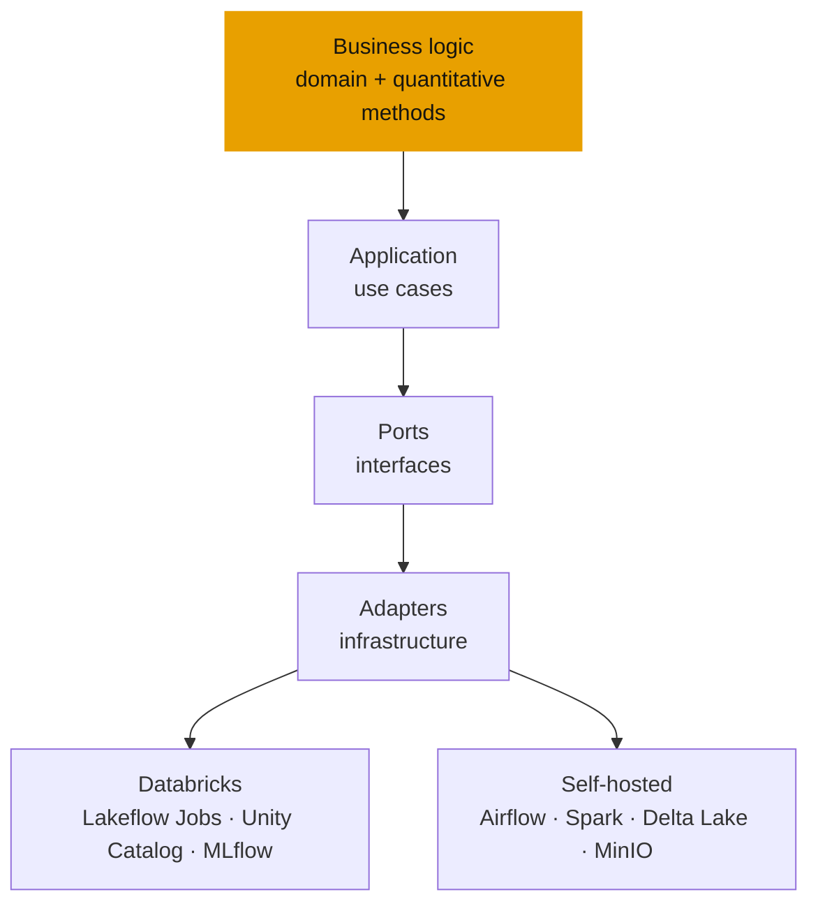

## The problem it tackles

Data platforms tend to grow around the tool they were first built on. Move from one platform to another and the business logic — the part that actually matters — has to be rewritten. QuantLab asks a different question: **what if the logic never knew which platform it was running on?**

<Callout tone="brand">The same code runs on Databricks and on a self-hosted stack. Only a thin layer of adapters changes.</Callout>

## How it is built

The project uses a hexagonal architecture, which keeps the platform-specific parts at the edge:

<Table
  data={{
    headers: [
      { content: "Concern", key: "concern" },
      { content: "On Databricks", key: "dbx" },
      { content: "Self-hosted", key: "self" }
    ],
    rows: [
      ["Orchestration", "Lakeflow Jobs", "Airflow"],
      ["Compute", "Spark on Databricks", "Apache Spark"],
      ["Tables", "Unity Catalog", "Delta Lake"],
      ["Experiment tracking", "Managed MLflow", "MLflow"],
      ["Object storage", "Cloud storage", "MinIO"]
    ]
  }}
/>

## The rules that keep it portable

- No Databricks-specific imports in the domain, application, quantitative or Spark code.
- No Airflow imports outside the Airflow orchestration folder.
- Every piece of infrastructure coupling lives in a dedicated adapter.
- Spark transformations stay portable, and the repository includes a place for cross-runtime compatibility tests.

## Why I built it

I work with Databricks, and I also run a Kubernetes homelab with Airflow, MLflow and object storage. QuantLab is where those two worlds meet: it is a way to learn what is genuinely platform-specific and what is not, and to keep my own work from being tied to a single vendor.

## Status

Early and in progress: the repository was started in September 2026. It sets out the architecture and the portability rules; it does not yet claim production results.
