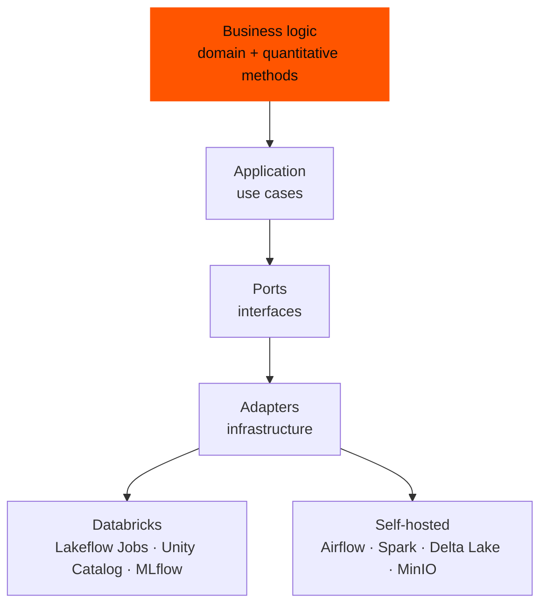
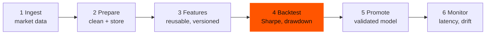

<Callout tone="neutral">QuantLab is the new version of a project I first called **Quant-MLOps**. It keeps the original goal and rebuilds the platform around a second one: portability.</Callout>

## Two problems, one project

**Research that cannot be reproduced.** In quantitative finance, research often lives in isolated scripts: a backtest is run, a number is noted, and a month later nobody can say exactly which data and parameters produced it. Models that look good in research rarely make it to production, and once there, little tells you whether they drift.

**Platforms that lock you in.** A data platform tends to grow around the tool it was first built on. Move to another one and the business logic, the part that matters, has to be rewritten.

QuantLab answers both. Every run is tracked so results are **comparable and trustworthy**, and the logic never knows which platform it is running on.

<Callout tone="brand">The same code runs on Databricks and on a self-hosted stack. Only a thin layer of adapters changes.</Callout>

## How it is built

The project uses a hexagonal architecture, which keeps everything platform-specific at the edge:

<Table
  data={{
    headers: [
      { content: "Concern", key: "concern" },
      { content: "On Databricks", key: "dbx" },
      { content: "Self-hosted", key: "self" }
    ],
    rows: [
      ["Orchestration", "Lakeflow Jobs", "Airflow"],
      ["Compute", "Spark on Databricks", "Apache Spark"],
      ["Tables", "Unity Catalog", "Delta Lake"],
      ["Experiment tracking", "Managed MLflow", "MLflow"],
      ["Object storage", "Cloud storage", "MinIO"]
    ]
  }}
/>

## The research flow

From raw market data to a monitored model, in six steps:

<Table
  data={{
    headers: [
      { content: "Step", key: "step" },
      { content: "What happens", key: "what" },
      { content: "Tooling", key: "tool" }
    ],
    rows: [
      ["Ingest", "Collect market data and trigger the pipelines on a schedule", "Airflow (or Lakeflow Jobs)"],
      ["Prepare", "Clean the data and store it as time series in open formats", "Parquet, Delta Lake, TimescaleDB"],
      ["Features", "Compute features once, and reuse them for training and for serving", "Feast"],
      ["Backtest", "Run Markowitz, Black-Litterman and Risk Parity strategies; log Sharpe ratio, maximum drawdown and turnover", "scikit-learn, PyPortfolioOpt, statsmodels, MLflow"],
      ["Promote", "Move a validated model from staging to production and serve it", "MLflow registry, FastAPI"],
      ["Monitor", "Watch latency, data drift and live performance", "Prometheus, Grafana"]
    ]
  }}
/>

## The rules that keep it portable

- No Databricks-specific imports in the domain, application, quantitative or Spark code.
- No Airflow imports outside the Airflow orchestration folder.
- Every piece of infrastructure coupling lives in a dedicated adapter.
- Spark transformations stay portable, and the repository includes a place for cross-runtime compatibility tests.

## Why I built it

I work with Databricks, and I also run a Kubernetes homelab with Airflow, MLflow and object storage. QuantLab is where those two worlds meet. It is a way to practise MLOps end to end on a realistic subject, to learn what is genuinely platform-specific and what is not, and to keep my own work from being tied to a single vendor.

## Where it stands

Early and in progress. The architecture and the portability rules are set out. The ingestion pipelines are being designed and the storage schema defined; experiment tracking, the feature store, the API and the dashboards are still to be wired up. It does not claim production results yet.

<Table
  data={{
    headers: [
      { content: "Next step", key: "next" },
      { content: "Planned", key: "plan" }
    ],
    rows: [
      ["Pipelines", "Stabilise daily ingestion, then compute the first features and run the first backtests"],
      ["Tracking and serving", "Plug in MLflow for model promotion, then expose the API and the monitoring"],
      ["Deployment", "Run it on the Kubernetes homelab (Helm, secrets, access control)"],
      ["Documentation", "A complete guide and reproducible use cases"]
    ]
  }}
/>
